# Design decisions: the audience screen

This is the record of how we redesigned the audience screen of ArtForAll for LA Hacks 2026
(Paper's design challenge), and why each choice was made. Codes such as `V01` point into our reference
log, [`inspiration.md`](inspiration.md). The product is called ArtForAll.

Sources: the spec (`docs/superpowers/specs/2026-10-17-audience-screen-revamp-design.md`), the Paper file
exported to [`paper/`](paper/), the tokens in `screen/src/design/tokens.css` and the strings in
`screen/src/design/copy.ts`.

## 1. The story (why this exists)

Our team went to teamLab in Tokyo. We walked through the water room, knee-deep in lit water, and through
works that react to the people in them and flow from one room into the next. It was the most immersive
art any of us had been in, and on the way out we realised almost all of it depends on sight. A blind
visitor could stand in the same water and miss most of what everyone else came for.

This project is our attempt to let them in. A voice guide tours a famous painting part by part, and a
10×10 board of balls raises the shape of the part being described, so the visitor feels it under their
hands.

The blind visitor never sees the audience screen. It is for the sighted people around them: judges at
the demo table and anyone walking past. Its job is to show, at a glance, what the visitor is hearing
and feeling right now. So we designed it like a room in a gallery rather than a dashboard.

## 2. Before / after

| Before | After |
|---|---|
| 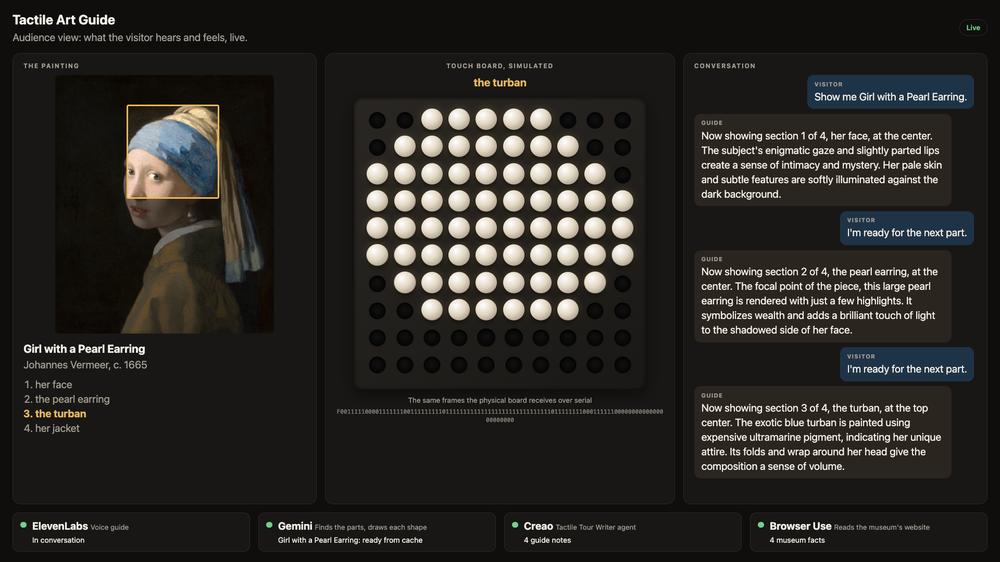 | 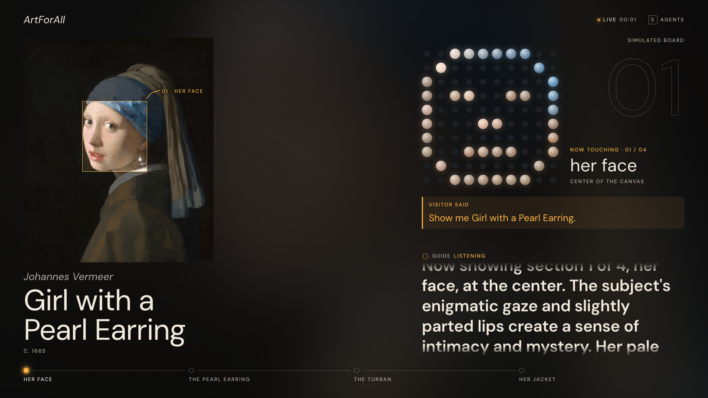 |

The Borderless flow mid-flight, the idle screen, and the agent drawer open:

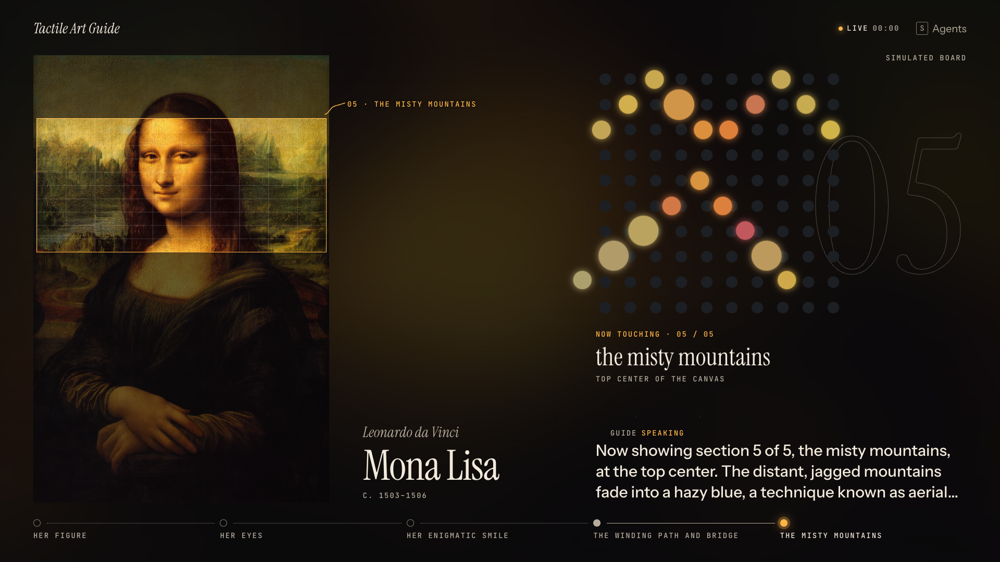

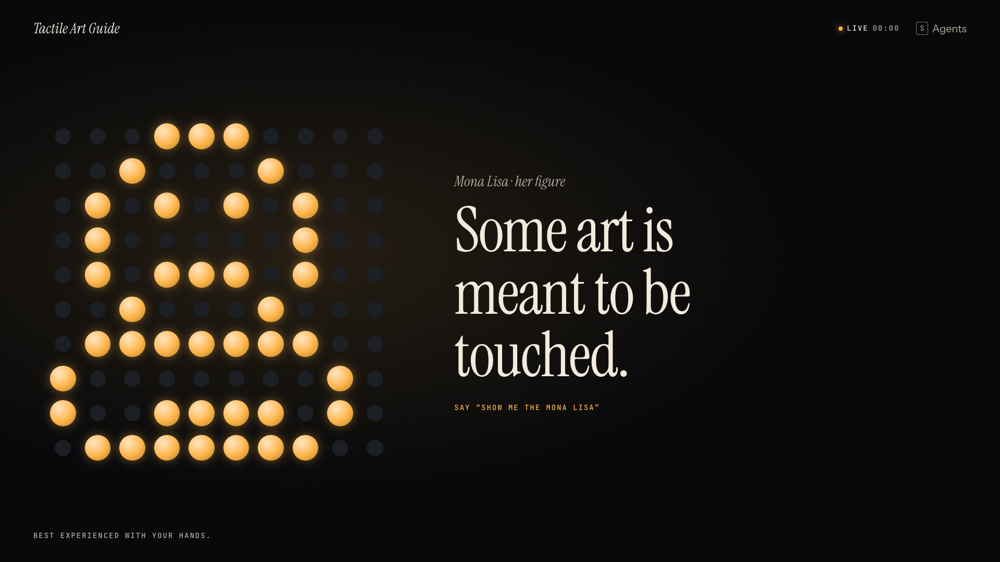

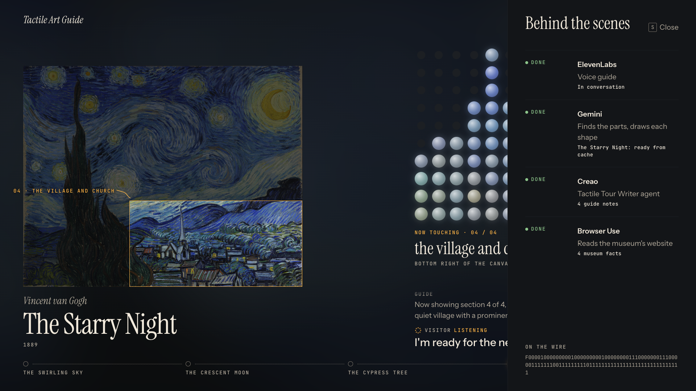

What changed: the old screen was a header, three boxed panels (painting, board, conversation) and a row
of four sponsor cards, with the conversation as chat bubbles. Now it is one continuous dark room with no
boxes: the painting and its wall label on the left, the board and the spoken captions on the right, and
the tour as a rail of balls along the bottom. The system font became a placard type system (serif
titles, sans captions, mono labels). The gold box on the painting became a spotlight that dims the rest
of the canvas, and when the tour moves on, the part flows across the room into the board instead of
just switching. The sponsor cards moved into a drawer that is closed by default.

More states are in `screens/`: `after-looking-up-1920.png`, `after-offline-1920.png`,
`after-reduced-1920.png`, `after-touring-1440.png`, `after-touring-1280x720.png`, `after-narrow-400.png`. Only the touring scene was captured at 1440×900; the other scenes were captured at 1920×1080 (and the narrow and projector sizes above).

Note: `npm test` in `screen/` needs Node 22.6 or newer (it runs the TypeScript tests with type stripping).

## 3. How we worked

1. **Audit.** We listed the 5 sections of the old screen (header, painting, board, conversation, sponsor
   cards) and the states each one could be in, such as the empty screen before a tour. We also listed what
   was missing: who is talking, how far through the tour we are, and what a judge sees before a tour
   starts.
2. **References.** We collected 147 screens on Mobbin in 9 sections (painting viewer, spotlight, touch
   board, conversation, speaking indicator, tour progress, sponsor panel, header, idle screen). For each
   one we wrote what is on it and what we liked and disliked. 23 are marked STRONG. The log is
   [`inspiration.md`](inspiration.md); the images are in `inspo/`.
3. **Seven patterns** kept coming back:
   1. Darkness, with light as the material.
   2. Serif display with mono labels: a museum placard.
   3. Dots as the shared language, because the board is made of balls.
   4. A huge numeral answers "where am I?"
   5. Hand-made marks beat the generic look.
   6. The interface takes its colour from the art.
   7. Avoid blue-purple gradients, glowing orbs, log tables and stacks of cards.
4. **Three directions.** A "Borderless Night", B "Wall Label", C "Pin Art" (section 7 explains B and C).
5. **The choice.** A, with B's typographic discipline.
6. **Paper.** We designed it in Paper alongside the code: story, research, design system,
   components, screens and the flow storyboard. Export:
   [`paper/artforall-design.pdf`](paper/artforall-design.pdf) (20 pages, plus one PNG per
   page in [`paper/`](paper/)). The PDF is assembled from the page images, so its text can't be
   selected. Some detail text in the Paper screens is mockup copy we wrote for the design (the agent
   detail lines in the drawer and the Starry Night captions), not output from the live app.
7. **Code that matches it.** Paper drove layout decisions (for example the wall label beside the painting) and we matched the build to it. The token names in `tokens.css` are the same as the Paper file's. We then
   screenshotted every scene of the built screen and compared the touring screens side by side with
   Paper, and fixed what differed (label wrapping under landscape paintings, caption fade, the spotlight
   tag running off narrow screens, keycap font).

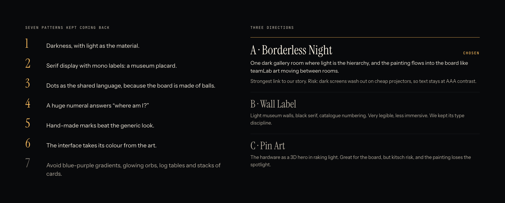

## 4. Judging criteria → decisions

| Criterion | Decision | Evidence |
|---|---|---|
| Hierarchy | Light is the only hierarchy: what matters is lit, the rest sits in the dark. One lantern accent (`#FFB547`) means "now": the current part, the live dot, the spotlight edge, the current rail stop. Strong scale contrast between serif display (80px) and mono labels (14px). | `after-touring-1920.png`; `paper/3-type.png`; spec §3 |
| Legibility | Text colours meet AAA on the ink background: paper 16.7:1, paper-dim 8.8:1. 13px is the smallest text anywhere. Captions show the newest line largest and step older lines down. While the guide answers, the visitor's last words stay pinned above the answer under "Visitor said", so anyone walking up mid-answer can see what was asked. Type is sized to be read from about 3 m away (our target; not measured on site). | `tokens.css`; Task 16 check found 0 text elements under 13px |
| Consistency | One shape language: the ball (wells, raised balls, rail stops, speaking dots, live dot). One token set shared by Paper and CSS with identical names. A 4/8px spacing scale (`--spacing-1…10` = 4 to 128px). | `tokens.css`; `paper/3-space-shape-motion-voice.png` |
| Contrast | See the ratios table in section 8. `paper-faint` (4.5:1) is restricted to decoration and text 24px and larger (the outline numeral, hairlines). | `paper/3-colour.png` |
| Ease of use | Nothing to click: the screen follows the voice tour on its own. One key, `S`, opens the agent drawer (`Esc` closes it). Every status has a word as well as a colour (WORKING, DONE, FAILED; speaking, listening, thinking). The offline and idle screens say what is going on and what to do ("The guide is on a break. Start main.py to open the gallery."). | `after-drawer-1920.png`, `after-offline-1920.png`; `copy.ts` |
| Craft and character | The Lantern Water palette, where every colour is an object in the teamLab water room. A hand-drawn hook that hangs the part name on the spotlight. The Borderless flow (section 6). Raised balls take the colour of the painting under them. Copy in a museum voice. | `paper/3-colour.png`; `after-flow-1920.png`; section 5 |

## 5. Design system decisions ("Lantern Water")

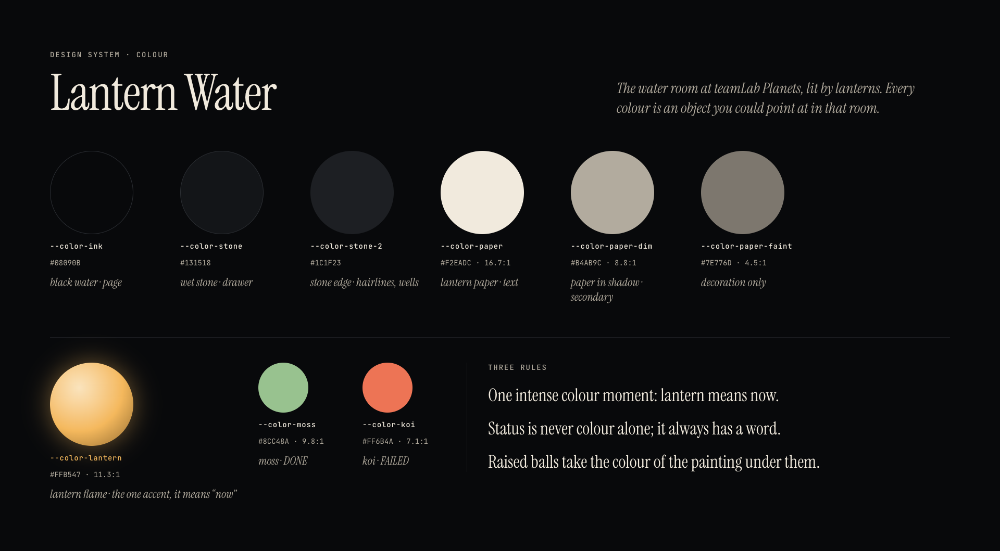

### Colour

- **Decision.** A dark palette named after the water room at teamLab Planets lit by lanterns: ink
  `#08090B` (black water), stone `#131518` (wet stone), stone-2 `#1C1F23` (stone edge), paper `#F2EADC`
  (lantern paper), paper-dim `#B4AB9C`, paper-faint `#7E776D`, lantern `#FFB547` (the flame). Moss
  `#8CC48A` and koi `#FF6B4A` appear only in the drawer, for DONE and FAILED.
- **Reason.** Every colour is something you could point at in that room, which keeps the palette small
  and gives it a reason. One intense colour, used only for "now", means a judge's eye always lands on
  the current part.
- **Painting-coloured UI ← Savee P03 + TIDAL P09.** The room glow is the painting's average colour at
  12% over ink, and each raised ball takes the average colour of its own cell in the painting, lifted to
  at least 55% lightness so it glows. If the image can't be read, the balls fall back to lantern.
- **Accent as state ← Polestar B20** (state words in an accent colour).

### Type

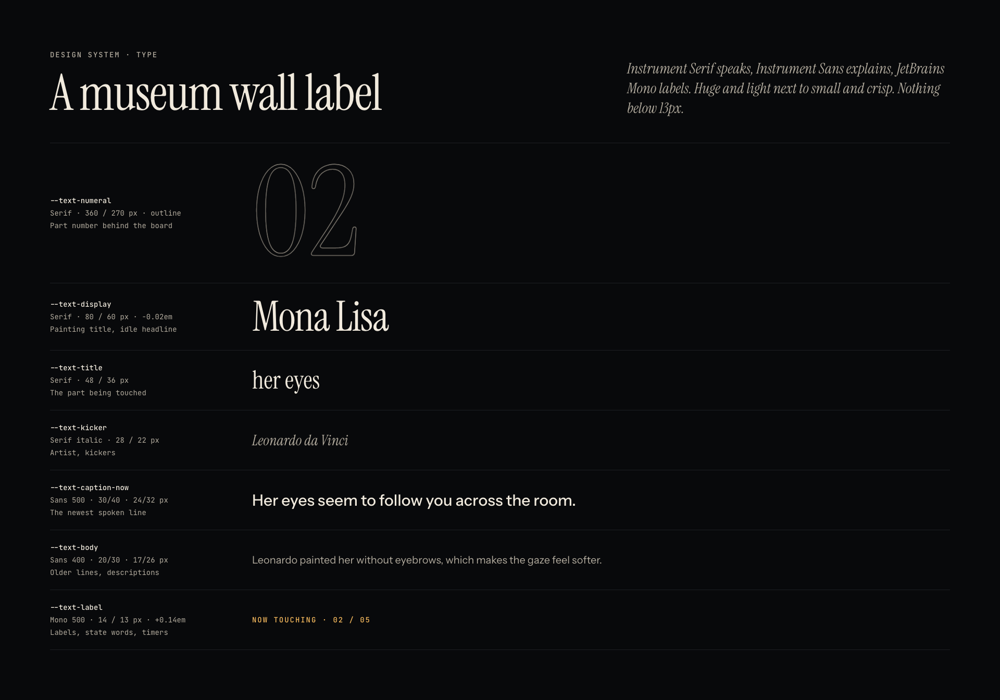

- **Decision.** Instrument Serif for the painting title (80px), part name (48px) and italic kickers;
  Instrument Sans for captions (30px newest, 20px older); JetBrains Mono uppercase with +0.14em tracking
  for labels (14px, never under 13px). All self-hosted.
- **Reason.** A gallery wall label already solves "artist, title, year" in a way everyone recognises.
  Mono labels read as the gallery's catalogue numbering and separate "data" from "words spoken".
- **Placard lockup ← Harvest I03** (italic kicker, title, byline). The wall label sits beside the
  painting and shares its bottom edge, and wraps under it for landscape paintings.
- **Giant numeral ← Polestar B20**, drawn as an outline (transparent fill, 1px paper-faint stroke)
  behind the board, like the hairline wordmark in Chronicle I26.
- Serif numerals with hairline rules ← Hers T03; mono micro type ← Studio Freight I07.

### Space

- **Decision.** Designed at 1920×1080, scaled to 1440×900 with `clamp()`, tightened for 1280×720 so it
  fits with no scrolling, stacked into one column below 1100px. Column split 58/42 (painting / board),
  gutter up to 96px, outer margin up to 64px.
- **Reason.** The painting is the hero, as in mymind P01 (artwork about two thirds of the width), but
  the board has to be big enough to read the shape from across a table.

### Shape

- **Decision.** Only circles and hairlines. No cards, no rounded panels, no drop shadows;
  glow is the only depth. The one exception is the pinned "Visitor said" strip: a lantern rule on the
  left over an 8% lantern tint, so the question still reads when a long answer fills the column. One hand-made mark: the spotlight tag's hook is a hand-drawn SVG stroke.
- **Reason.** The board is made of balls, so the ball became the unit of the whole interface: wells,
  raised balls, rail stops, the live dot and the speaking ring.
- **Dot grid ← Variant B05 + one year B15** (a coarse dot grid reads as an image; hand-drawn marks on a
  dot grid).
- **Rail ← Gusto T01 + Etsy T08.** One ball per part: visited filled in paper-dim, current in lantern
  with a halo, upcoming as a hollow ring, joined by a solid line behind you and a dotted one ahead.
- **Hand-drawn hook ← one year B15** and pattern 5.

### Motion

- **Decision.** Two easings: `--ease-rise` `cubic-bezier(.34,1.56,.64,1)` (balls overshoot a little as
  they come up) and `--ease-light` `cubic-bezier(.22,1,.36,1)` (light settles softly). Durations: ball
  400ms, row stagger 70ms, spotlight 600ms, flow 900ms, ripple 1600ms. With reduced motion, the ball rise and spotlight become
  200ms fades; the flow is skipped and the ripple stops.
- **Reason.** Things that are physical (balls) bounce; things that are light glide.
- **Speaking ripple ← Delphi V01 + PlayAI V03.** A ring of 8 dots next to the newest caption: rings
  ripple outward while the guide is speaking (ripples in water), dots orbit while it is thinking
  (← Delphi V12), and breathe slowly while it is listening. The state is always written next to it.
- **Live tag ← Substack H04** ("LIVE 03:12").

### Voice

- **Decision.** Copy reads like a museum placard: "Now touching", "Best experienced with your hands.",
  "The guide is on a break.", "Behind the scenes", "On the wire". Never "Status: OK", "Section loaded"
  or "AI-powered". Every string lives in `copy.ts`.
- **Idle copy ← Cosmos I15 + Visitors H10.** Cosmos says "Best experienced with headphones."; ours says
  "Best experienced with your hands." Visitors showed that an empty state can be warm instead of an
  error.
- **Drawer ← Base44 A07.** The sponsor activity is a slide-over drawer titled "Behind the scenes". It
  covers the right column without moving the layout, and is closed by default so it never competes
  with the tour.

## 6. The signature moment: Borderless flow

| 1 · Spotlight glides | 2 · The part lights up |
|---|---|
| 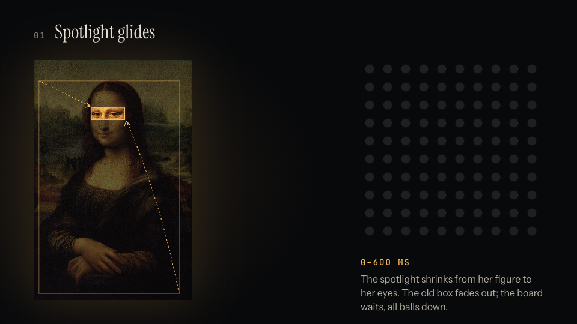 | 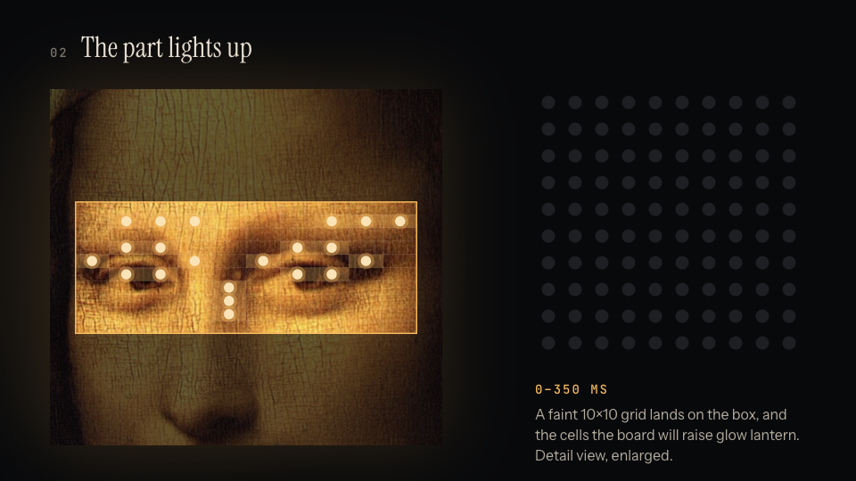 |
| **0–600 ms.** The spotlight leaves the old part and glides to the new one. | **0–350 ms.** A faint 10×10 grid fades in over the part; the cells that will be raised light up. (Frame 2 is an enlarged detail so the grid is readable.) |
| **3 · Dots fly** | **4 · Balls rise** |
| 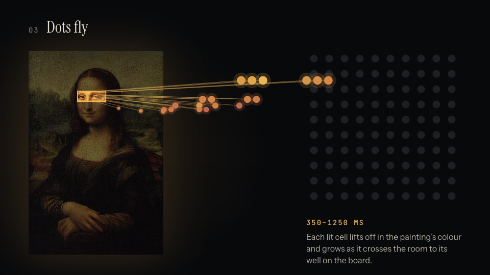 | 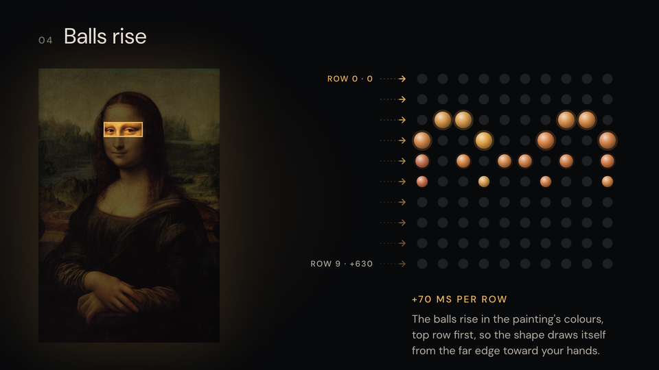 |
| **350–1250 ms.** Each lit cell lifts off in the painting's colour and grows as it crosses the room to its well on the board. | **+70 ms per row.** The balls rise row by row, top row first, and keep their painting colour. |

Why it matters: in one motion it shows the idea of the whole project. This part of the painting becomes
this shape under the visitor's hand. A judge who has never heard our pitch can watch it once and
understand what the board is for. It is also our version of teamLab's art flowing from one room into
the next.

In code it is at most 100 dots moved with CSS transforms, no animation library. It is skipped (the
balls just fade in) when reduced motion is on, when positions can't be measured, and for the first part
of a painting, where there is nothing to fly from yet.

## 7. What we rejected and why

- **Direction B, "Wall Label"** (light museum walls, black serif, catalogue numbering). Very legible,
  but it reads as a museum website, not a room you are inside. We kept its type discipline.
- **Direction C, "Pin Art"** (the board as a 3D hero in raking light). Great for the board, but it risked
  kitsch and the painting lost the spotlight.
- **Blue-purple AI orbs and iridescent glows** (Meta AI C01, Shopify Sidekick V10). They are the look
  of every AI product right now and say nothing about art or touch. Our speaking indicator is made of
  the same dots as the board instead.
- **Log tables** (Braintrust A02, OpenAI Platform A10). Too dense for a screen people glance at from a
  few metres away. The drawer shows one row per agent with a status word and one detail line.
- **Chat bubbles.** They made the conversation look like a messaging app and took a third of the
  screen. Captions with the newest line largest read more like subtitles in a gallery.
- **Cards.** Boxes split one experience into three. The new screen has no cards; the only tinted
  strip is the visitor's pinned question, added after a live test where long answers pushed it off screen.
- **A light mode.** We committed to the dark teamLab room. The risk we noted is that dark screens can
  wash out on cheap projectors; our answer was to keep text at AAA contrast. We have not tested the
  screen on a projector; we only checked that it fits a 1280×720 viewport with no scrolling.

## 8. Accessibility of the screen itself

The screen is for sighted viewers, but it should still be easy to read and safe to watch.

| Token | Hex | On ink `#08090B` | Use |
|---|---|---|---|
| paper | `#F2EADC` | 16.7:1 | primary text |
| paper-dim | `#B4AB9C` | 8.8:1 | secondary text |
| paper-faint | `#7E776D` | 4.5:1 | decoration and 24px+ only |
| lantern | `#FFB547` | 11.3:1 | "now" |
| moss | `#8CC48A` | 9.8:1 | DONE (drawer) |
| koi | `#FF6B4A` | 7.1:1 | FAILED (drawer) |

- **Words alongside colour.** Agent status shows WAITING, WORKING, DONE or FAILED next to its dot. The
  speaking indicator writes speaking, listening or thinking. The board writes "Now touching · 03 / 04",
  the part name and its location ("top center of the canvas").
- **Reduced motion.** With `prefers-reduced-motion`, the ball rise and spotlight become 200ms fades,
  the row stagger is removed, the flow is skipped, and the ripple and pulse stop. Screenshot:
  `screens/after-reduced-1920.png`.
- **Screen readers.** Captions are an `aria-live="polite"` region. The ball grid is `role="img"` with a
  label such as "40 of 100 balls raised". The drawer is labelled "Behind the scenes". The `S` keycap is
  a real button with a visible lantern focus ring.
- **No tiny text, no sideways scroll.** Nothing under 13px; at 400px wide the page is one column with no
  horizontal scroll; at 1280×720 nothing scrolls.

Known gaps: opening the drawer does not move keyboard focus into it; on the tour rail, visited and
current parts differ by fill and colour (the part names are always written); and the ball grid's label
counts the raised balls a moment before they visibly land during the flow.

## 9. Devpost: "Design" section (ready to paste)

We went to teamLab in Tokyo and stood in a room of lit water where the art reacted to us and drifted
from one room into the next. It was the best art we had been inside, and almost all of it was for the
eyes. Our project lets a blind visitor feel a painting: a voice guide tours it part by part while a
10×10 board of balls raises the shape of each part under their hands.

The screen is for everyone else in the room. We audited the five panels of our first version, saved 147
reference screens with notes on what we liked and disliked, found seven patterns, and sketched three
directions. We chose "Borderless Night": one dark room where light is the only hierarchy.

The palette, Lantern Water, comes from that water room: black water, wet stone, lantern paper, and one
lantern orange that only ever means "now". Titles are set in a serif and labels in mono, like a gallery
wall label, and body text sits at 16.7:1 contrast. The only shapes are circles and thin lines, because
the board is made of balls.

When the tour moves on, the spotlight glides to the next part, its cells light up, and they fly across
the screen as dots and land on the board as balls in the painting's own colours. We designed it in
