# Inspiration log

Collected 2026-10-17 with the Mobbin MCP for the audience-screen revamp (Paper "Best Designed Hack" track).
Every screen is saved in `docs/design/inspo/` (Mobbin image links expire after 30 days). Click a name to open it on Mobbin.

How to read each entry:
- **Seen**: what is on the screen (colour, type, size, position).
- **Take / leave**: what we like and want to borrow, and what we don't like. **STRONG** marks the ones that shaped the final design.

Total: 147 references across 9 sections.

## 1. Painting viewer

What the current `PaintingView` does: the painting, its title and artist, and the list of parts.

14 references.

### P01 · [mymind](https://mobbin.com/screens/c4cca66d-7fc7-4f88-a524-bf4a2f5f1920)

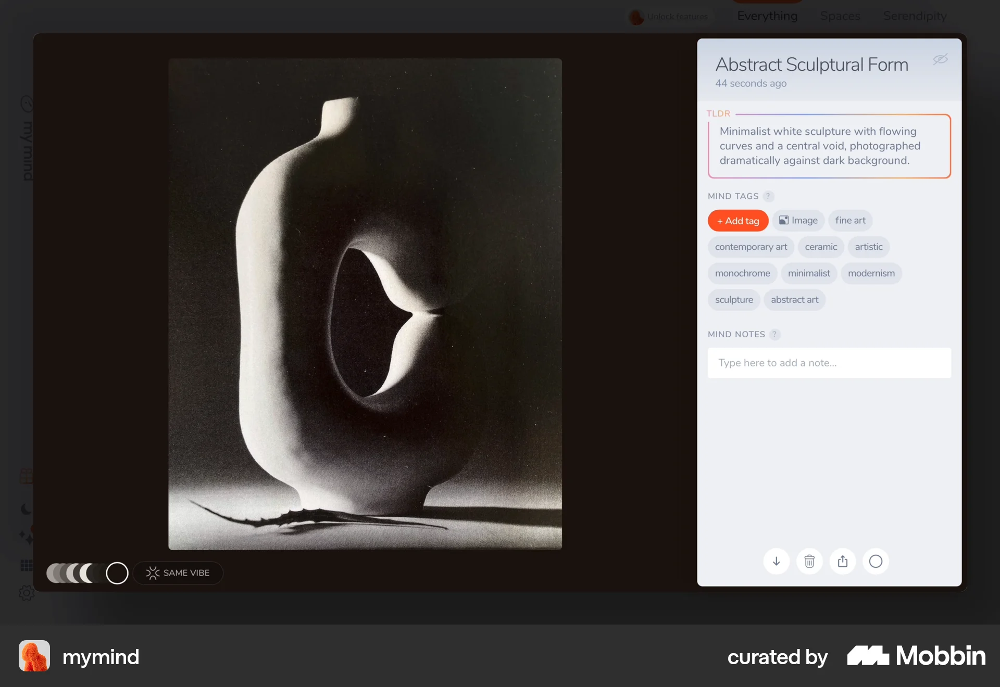

- **Seen:** charcoal stage, artwork floats w/ big margins; light side card; orange-outlined "TL;DR" callout; tiny caps labels
- **Take / leave:** Like: artwork ~65% width as hero; TL;DR callout = one-line "what you're touching" DISLike: light card on dark stage splits attention; tag soup

### P02 · [OpenSea](https://mobbin.com/screens/4cf9f04b-2df7-418d-bc0f-e7888fa2435b)

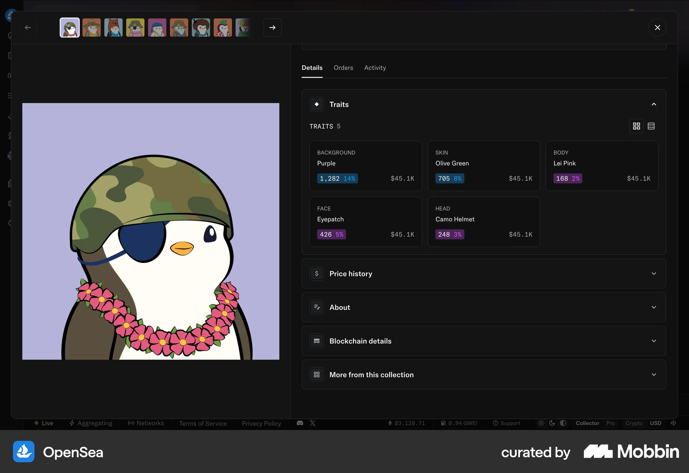

- **Seen:** thumbnail filmstrip across top to step through collection; trait cards w/ counts
- **Take / leave:** Like: filmstrip = section strip (crops of each part) DISLike: dense, finance/crypto tone

### P03 · [Savee](https://mobbin.com/screens/eb170b0f-521a-4e73-8f3b-24488fb0a5ab)

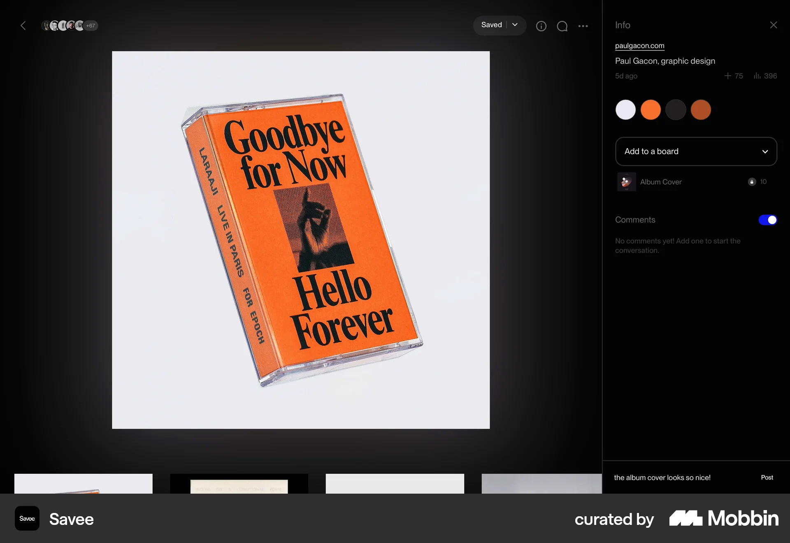

- **Seen:** pure black, radial vignette lifts artwork; auto-extracted 4-swatch palette from image
- **Take / leave:** Like: palette extraction -> UI accent takes the painting's colors (teamLab: room takes on the art) DISLike: tiny low-contrast metadata

### P04 · [Telescope](https://mobbin.com/screens/64aa2cd0-f577-45ef-99d8-746f119cb3cb)

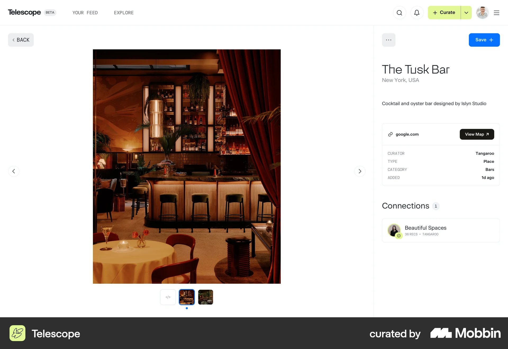

- **Seen:** light editorial; large title + muted location; mono UPPERCASE nav; key/value table (CURATOR/TYPE/ADDED)
- **Take / leave:** Like: mono key/value = museum wall placard DISLike: bright lime CTA noise

### P05 · [Reddit](https://mobbin.com/screens/c5c3a7d7-14a6-4f7d-90bf-4031bb60c464)

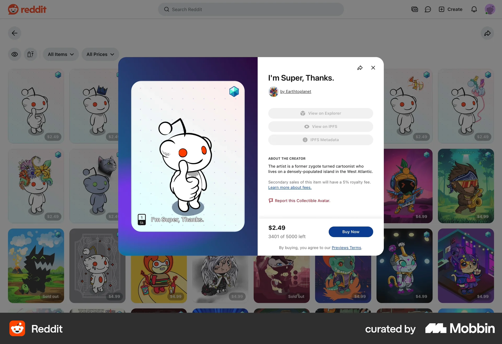

- **Seen:** gradient-backed card modal
- **Take / leave:** DISLike: generic marketplace, purple gradient = "AI look" to avoid

### P06 · [Curater](https://mobbin.com/screens/47aa2965-d72e-4033-b7fb-63bfd1e83823)

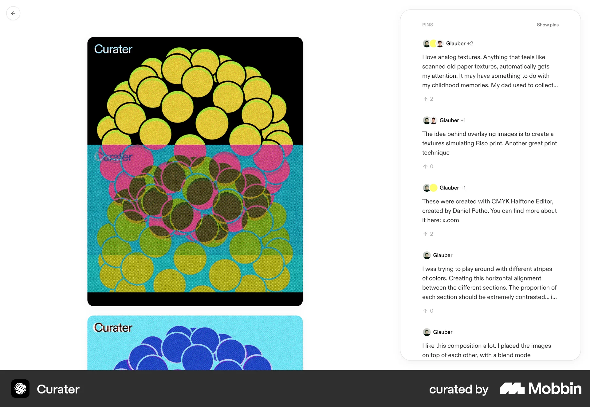

- **Seen:** artwork left, pinned notes column right
- **Take / leave:** Like: notes column paired with art = guide notes beside painting

### P07 · [Disney+](https://mobbin.com/screens/9e3722ed-0da1-4aee-8abc-c657df4207fc)

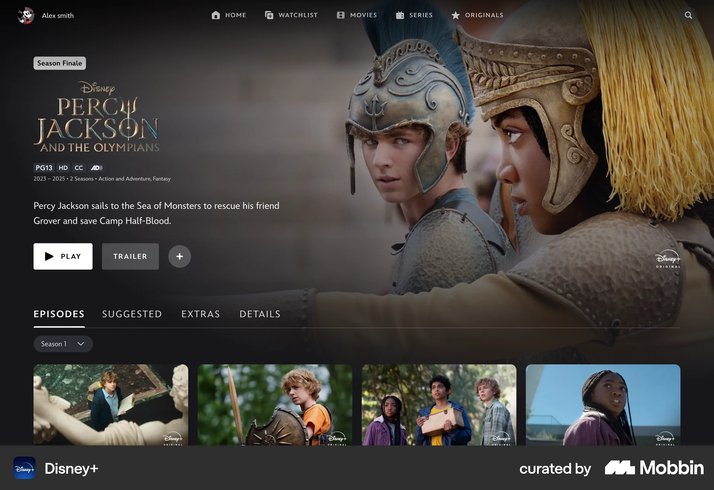

- **Seen:** full-bleed hero image, dark left scrim, title lockup over image, tabs below
- **Take / leave:** Like: cinematic full-bleed + scrim for text legibility (idle screen) DISLike: streaming clutter

### P08 · [Magnific](https://mobbin.com/screens/b7023c62-2f20-4989-ba0c-bb735b851e1d)

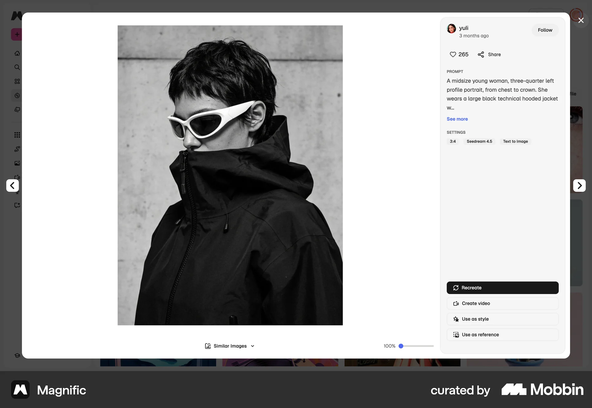

- **Seen:** white modal, photo + prompt sidebar, zoom slider
- **Take / leave:** Neutral.; DISLike: tool chrome

### P09 · [TIDAL](https://mobbin.com/screens/fa83c7bf-87b6-4d88-a5fb-70f998f7def0)

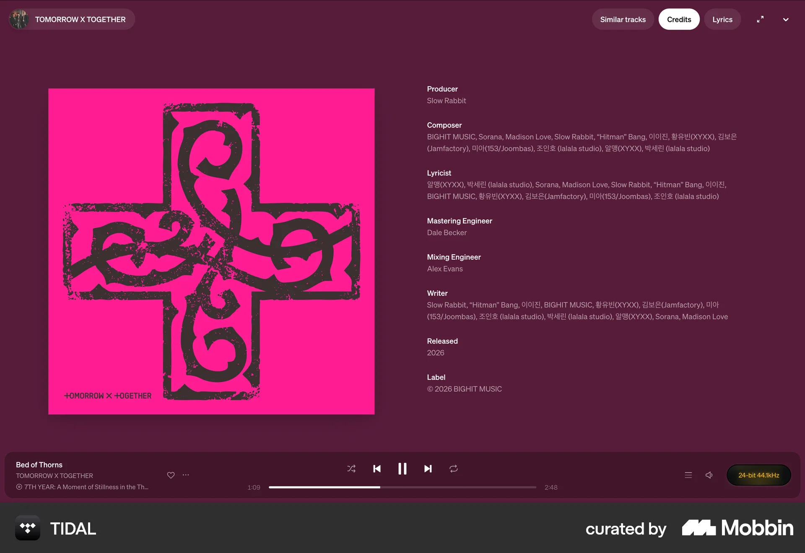

- **Seen:** whole page tinted from album art (maroon); label/value credits stack
- **Take / leave:** Like: ambient tint from art; stacked label/value

### P10 · [Visual Electric](https://mobbin.com/screens/05d3c06e-f343-42cc-8ec4-124b69eda8a3)

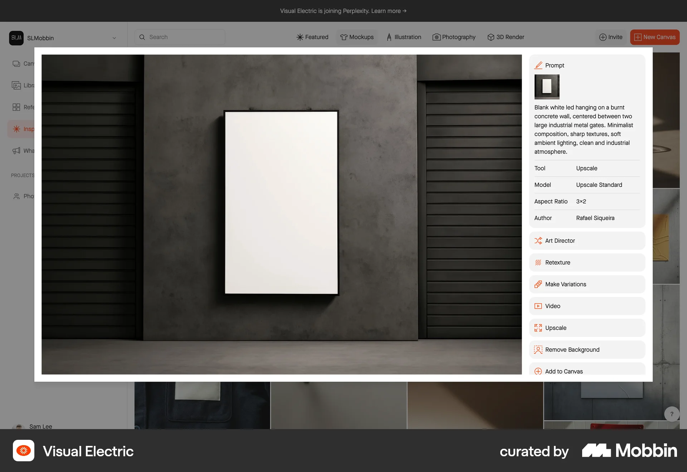

- **Seen:** artwork hung on a concrete wall mockup
- **Take / leave:** Like: "hung on a wall" presentation = gallery context, physical shadow

### P11 · [Krea](https://mobbin.com/screens/afe216b7-7d16-4397-b1d4-70df7135b189)

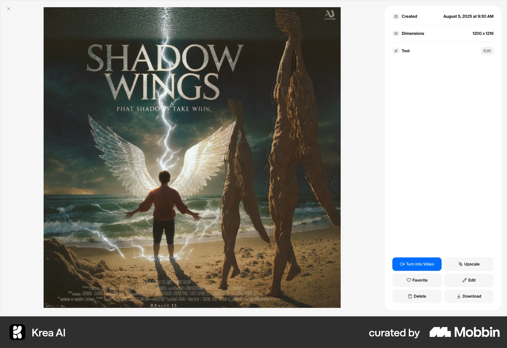

- **Seen:** image + sparse metadata
- **Take / leave:** DISLike: empty sidebar

### P12 · [Higgsfield](https://mobbin.com/screens/e5f17e4b-30a7-4ee5-9d5d-6a9454da870b)

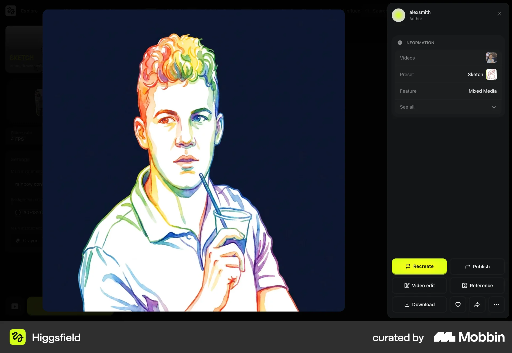

- **Seen:** navy stage, neon-yellow primary
- **Take / leave:** DISLike: neon on navy fights art

### P13 · [Recraft](https://mobbin.com/screens/df0d6d5b-2ebe-478d-be27-56dd738f7a07)

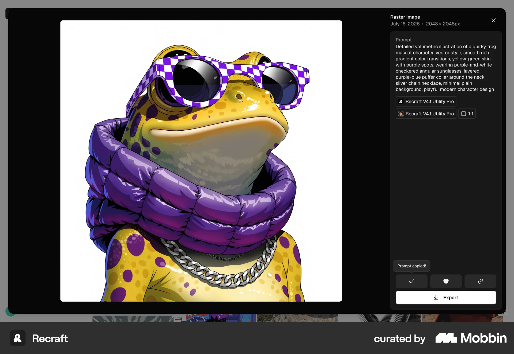

- **Seen:** dark modal, prompt card
- **Take / leave:** Neutral.

### P14 · [Meetup](https://mobbin.com/screens/997acca9-cac3-4bd6-87aa-bd5335638586)

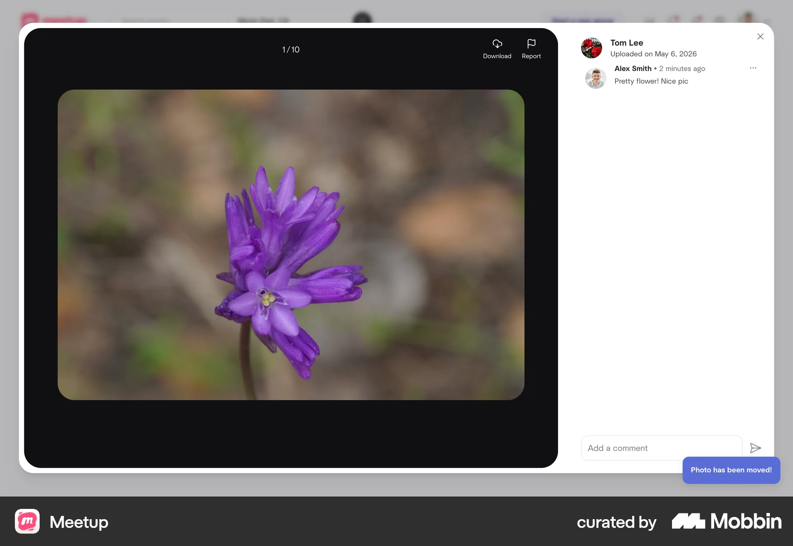

- **Seen:** "1/10" counter centered above photo
- **Take / leave:** Like: plain position counter -> "Part 2 of 6"

## 2. Spotlight on the current part

How to show which part of the painting is on the board (today: a gold box, everything else dimmed).

13 references.

### S01 · [Google Drive](https://mobbin.com/screens/85bdbb6d-bc3f-4a9c-86ee-9e0ae626d454)

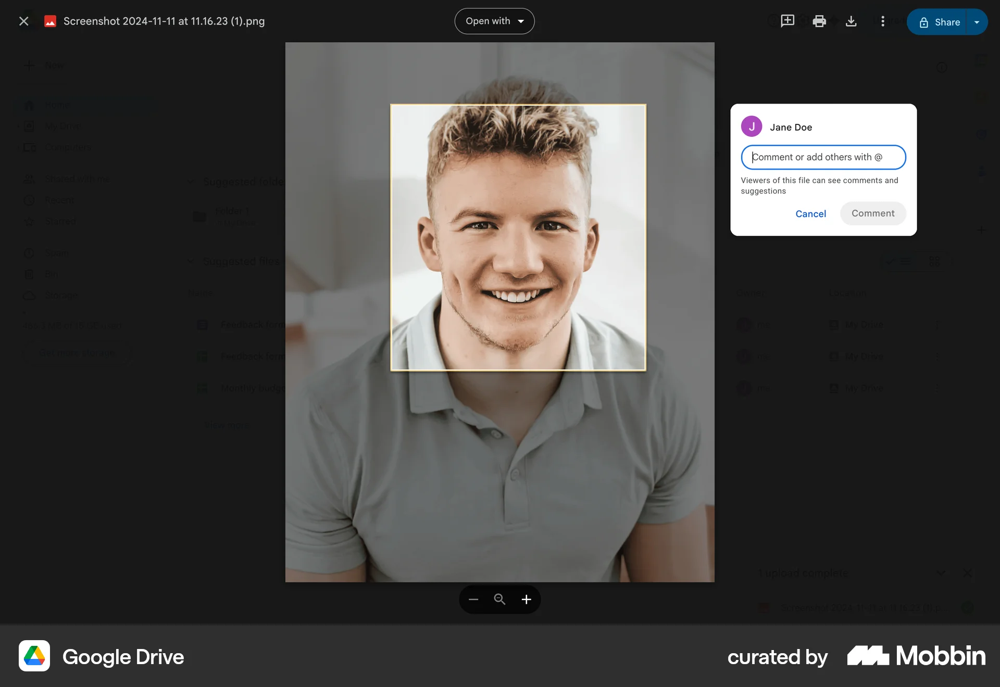

- **Seen:** region box w/ thin gold border, outside darkened
- **Take / leave:** Like: = our current bbox; hairline reads crisp DISLike: flat gray dim kills the painting's color

### S02 · [Magnific](https://mobbin.com/screens/5ea60921-5049-4a24-9821-eea39363e153)

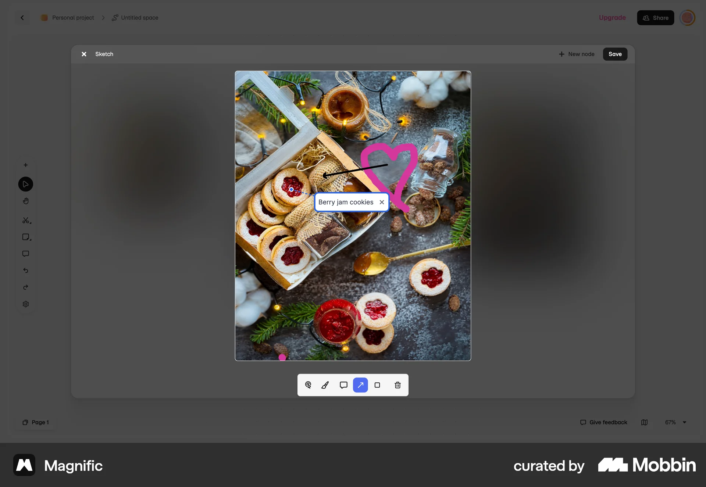

- **Seen:** label chip with leader line pointing to region
- **Take / leave:** Like: leader-line label naming the part ON the painting

### S03 · [Asana](https://mobbin.com/screens/c0e6bc14-16ea-41f0-a90a-aa064c15c3e4)

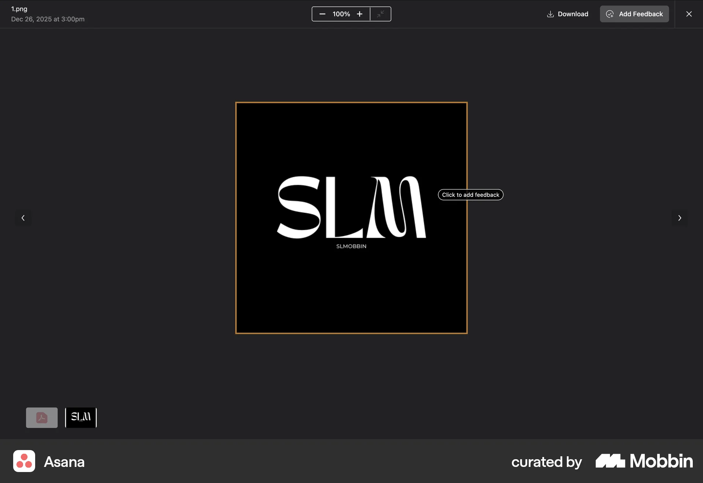

- **Seen:** amber 1px frame + pill tag attached to frame edge
- **Take / leave:** Like: tag docked to bbox corner

### S04 · [Grok](https://mobbin.com/screens/7bba8fce-a189-4cc8-8d65-b61555e7c912)

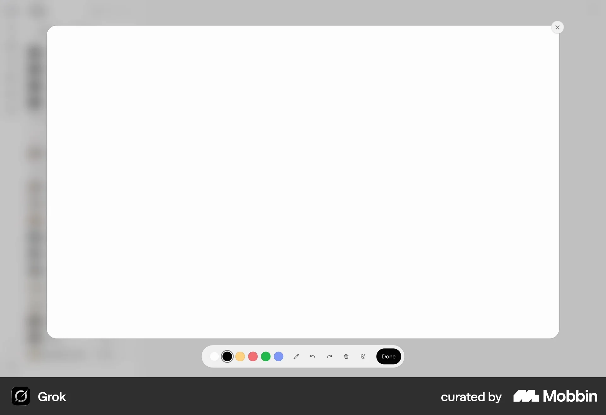

- **Seen:** blank canvas + floating color toolbar
- **Take / leave:** DISLike: irrelevant (kept for completeness)

### S05 · [Ghost](https://mobbin.com/screens/9e56f020-6057-4062-bf24-44f172422ba6)

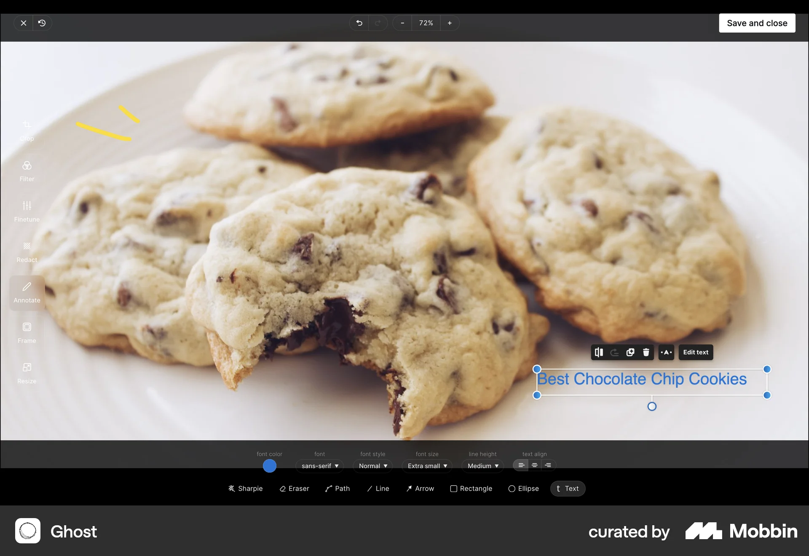

- **Seen:** text annotation w/ selection handles
- **Take / leave:** DISLike: editor chrome

### S06 · [Shopify](https://mobbin.com/screens/f2184364-19cf-4aed-92f6-b7d4b3ea1a43)

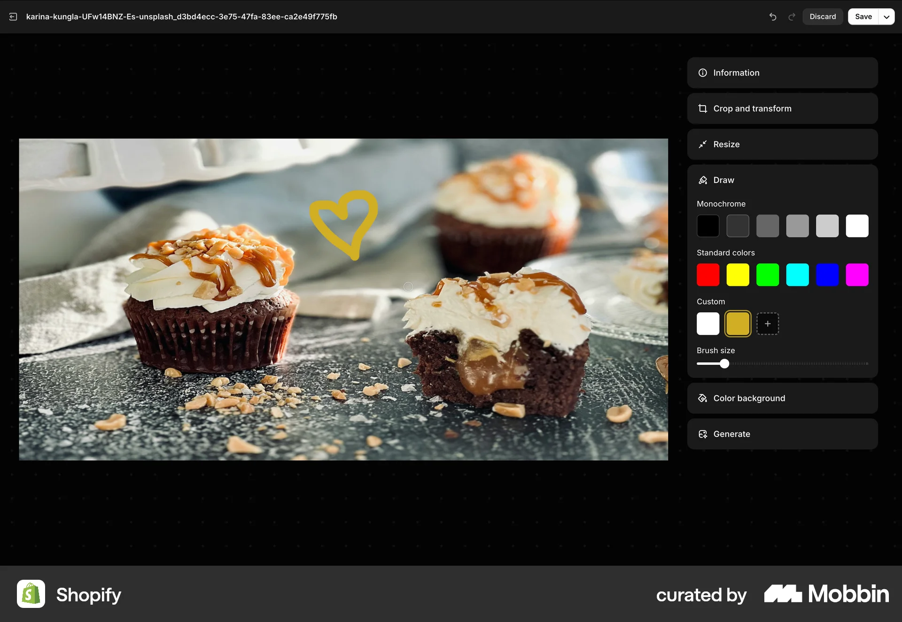

- **Seen:** dotted-grid canvas background
- **Take / leave:** Like: dot grid texture echoes the ball board

### S07 · [Air](https://mobbin.com/screens/2870a2e7-9c1a-48eb-a1e1-1a873cbefb2d)

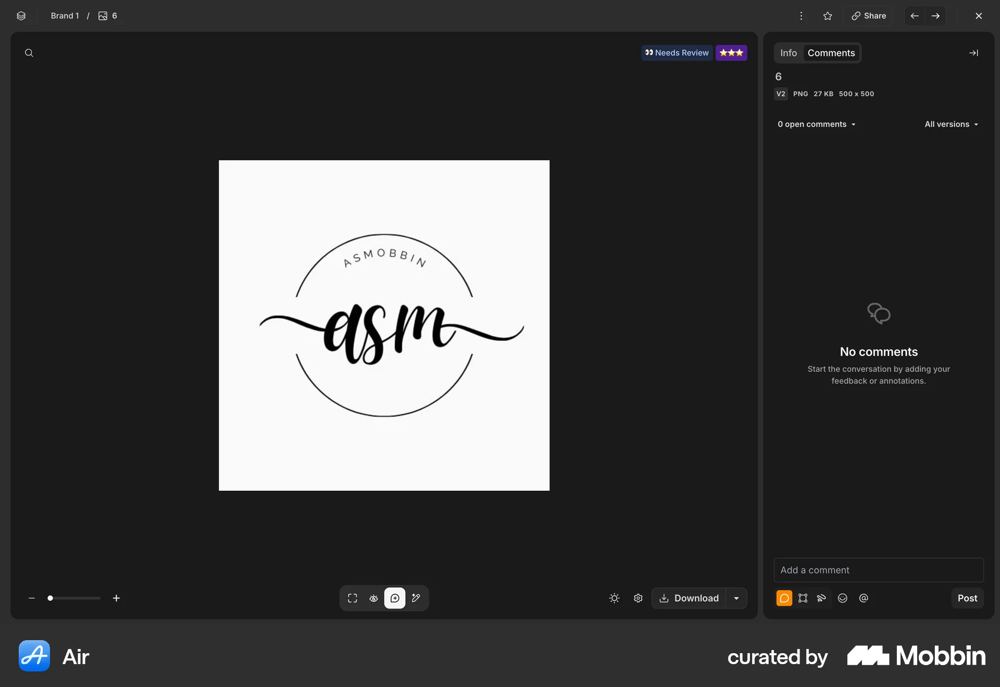

- **Seen:** dark viewer, floating pill toolbar bottom-center
- **Take / leave:** Like: floating pill for secondary controls (sponsor toggle)

### S08 · [Google AI Studio](https://mobbin.com/screens/f75e25a2-05eb-4fe8-8c7c-10cb6eb703a8)

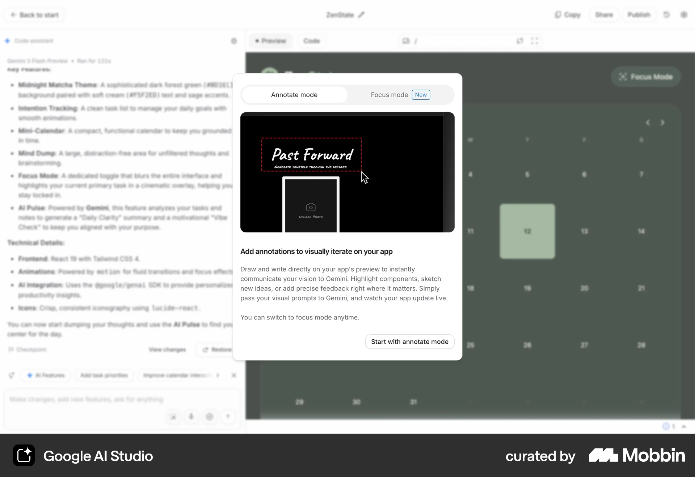

- **Seen:** red dashed marquee annotation on preview
- **Take / leave:** Like: dashed/"marching" marquee while Gemini is still finding a part

### S09 · [Bloom](https://mobbin.com/screens/3eed540e-eb1d-4b39-8c37-bb44892d652a)

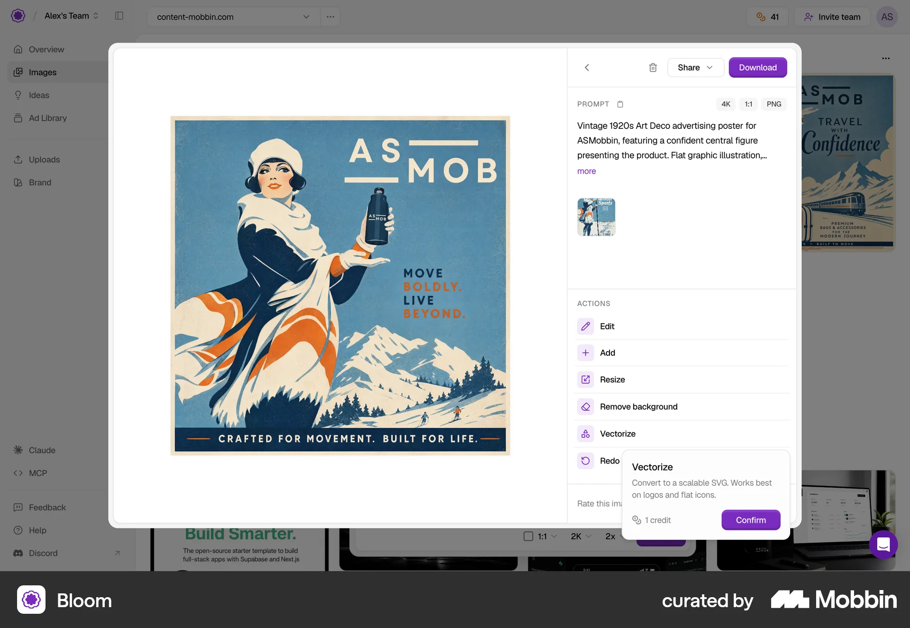

- **Seen:** art-deco poster, actions list
- **Take / leave:** Like: poster typography (bold condensed caps) for idle screen

### S10 · [Substack](https://mobbin.com/screens/5942a417-3d2b-46b2-9f9c-ce0665c3a837)

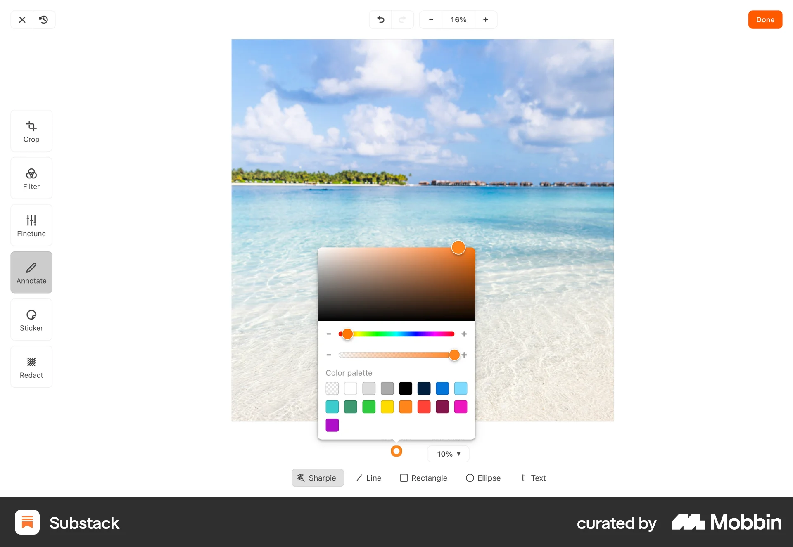

- **Seen:** annotate + color picker
- **Take / leave:** DISLike: tool chrome

### S11 · [ClickUp](https://mobbin.com/screens/a5284460-72ed-4c36-8079-c0e2fde7f4db)

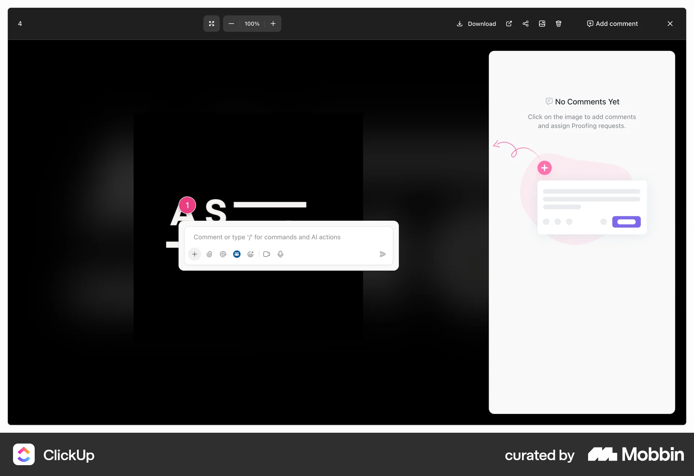

- **Seen:** numbered pink pin badge "1" on image
- **Take / leave:** Like: numbered pin = section number marker on painting

### S12 · [Curater pins](https://mobbin.com/screens/0e26e277-844a-48cf-975d-a7c6b16c8599)

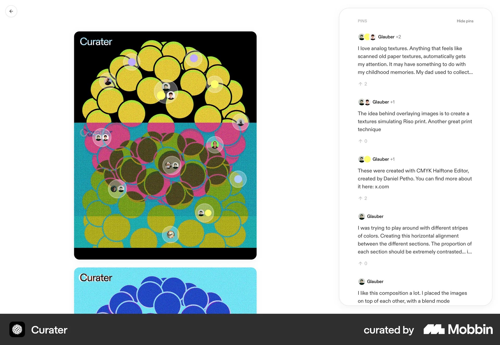

- **Seen:** many translucent circular pins scattered on art
- **Take / leave:** Like: all parts shown as faint pins, current one lit

### S13 · [Evernote](https://mobbin.com/screens/407d2bd0-0bc3-4d34-802f-bab8fe3be902)

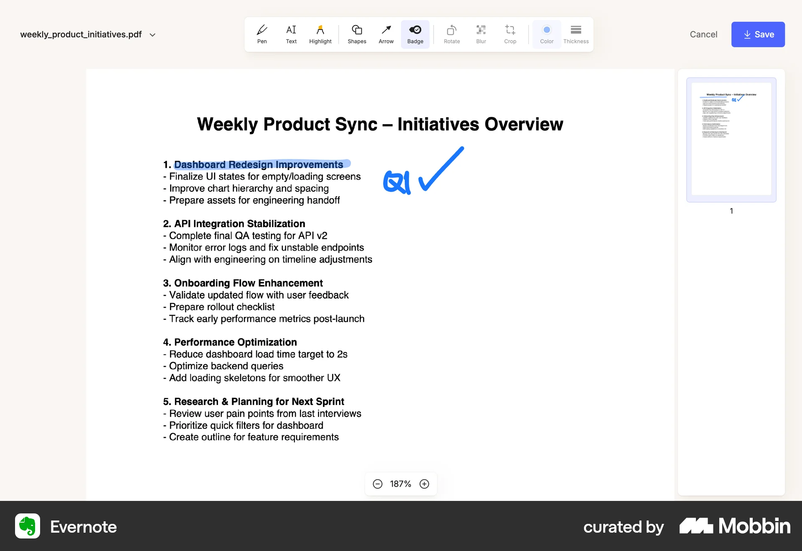

- **Seen:** hand-drawn highlighter marks
- **Take / leave:** Like: hand-made mark = human craft (criterion 3)

## 3. Touch board

The 10x10 ball board, mirrored or simulated (`Board`).

28 references.

### B01 · [Miro](https://mobbin.com/screens/1e8bac81-47b6-4f5b-a21b-529a2c09c54e)

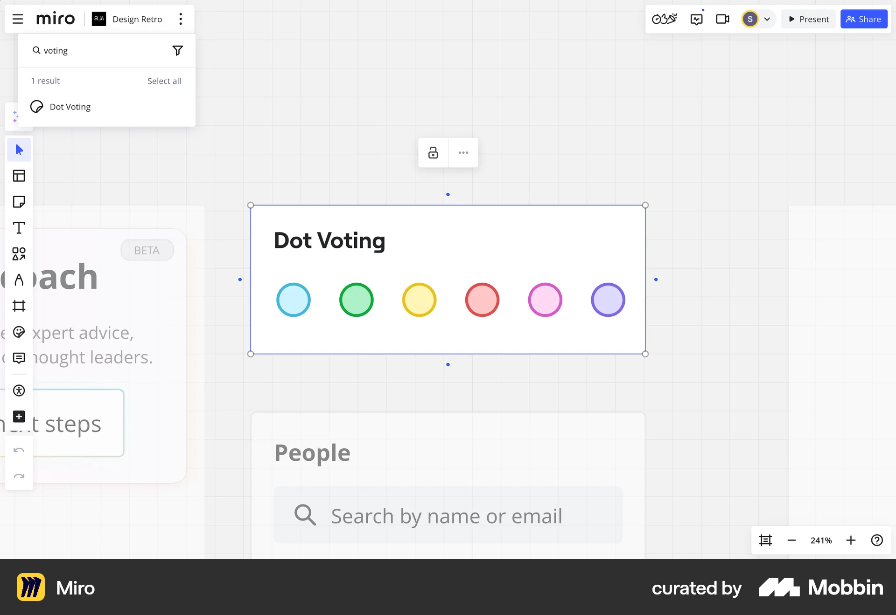

- **Seen:** "Dot Voting" row of hollow pastel rings
- **Take / leave:** Like: hollow ring = "ball down", filled = "ball up" state language DISLike: pastel rainbow

### B02 · [Railway](https://mobbin.com/screens/5d97ddda-d7ed-4834-8b22-e51d737ffb8a)

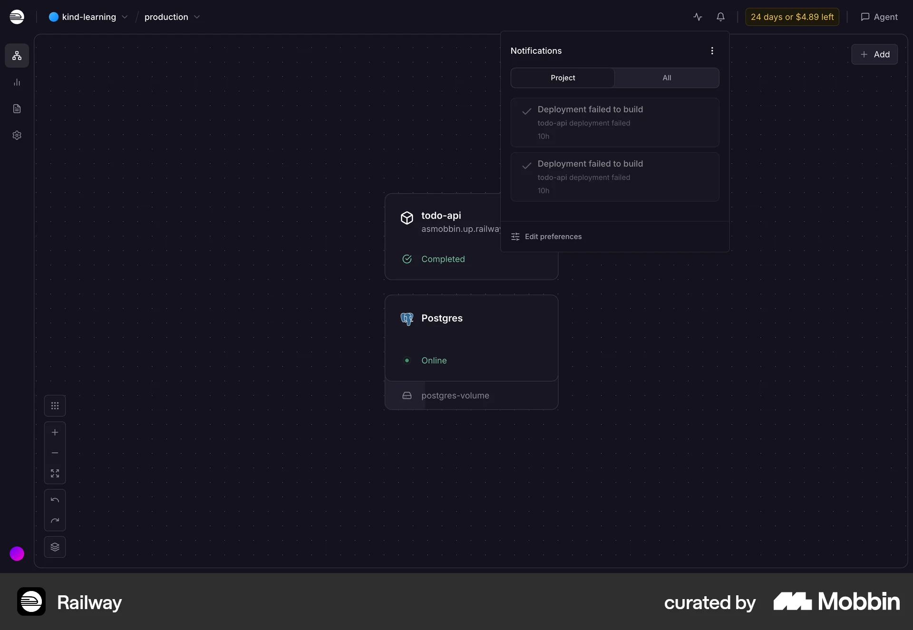

- **Seen:** near-black canvas, faint dot grid, cards w/ tiny green "Online" status
- **Take / leave:** Like: very faint dot grid as ambient texture, quiet status text

### B03 · [Wise](https://mobbin.com/screens/e72df0e6-2d3f-43ab-8c6a-b4f99dff8b1d)

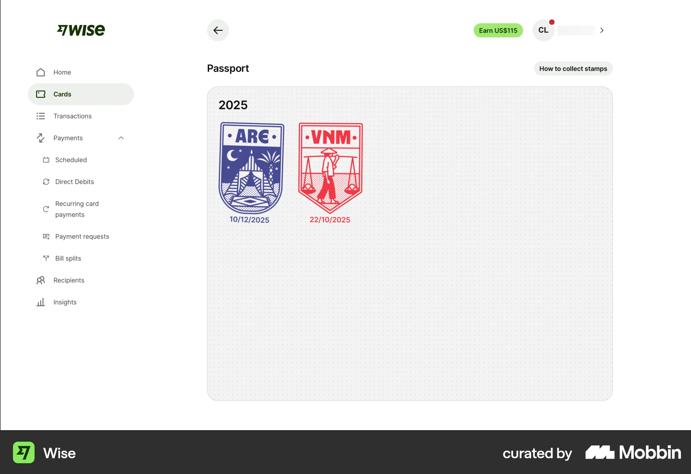

- **Seen:** "Passport" page, stamps on textured card with embossed dot pattern
- **Take / leave:** Like: embossed/debossed texture = tactility in a visual; stamps = collectible "you visited" idea for parts toured

### B04 · [Weavy](https://mobbin.com/screens/c08a2be4-1418-4217-9795-81932e345167)

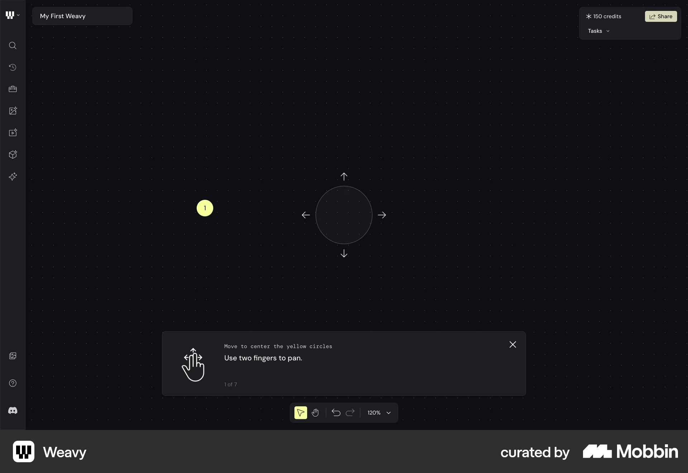

- **Seen:** dark canvas, yellow numbered circle + mono instruction card "1 of 7"
- **Take / leave:** Like: mono caption + "1 of 7" step counter; single yellow accent on black

### B05 · [Variant](https://mobbin.com/screens/d3e99e7b-83de-4e76-8b61-6db441ff4ce1)

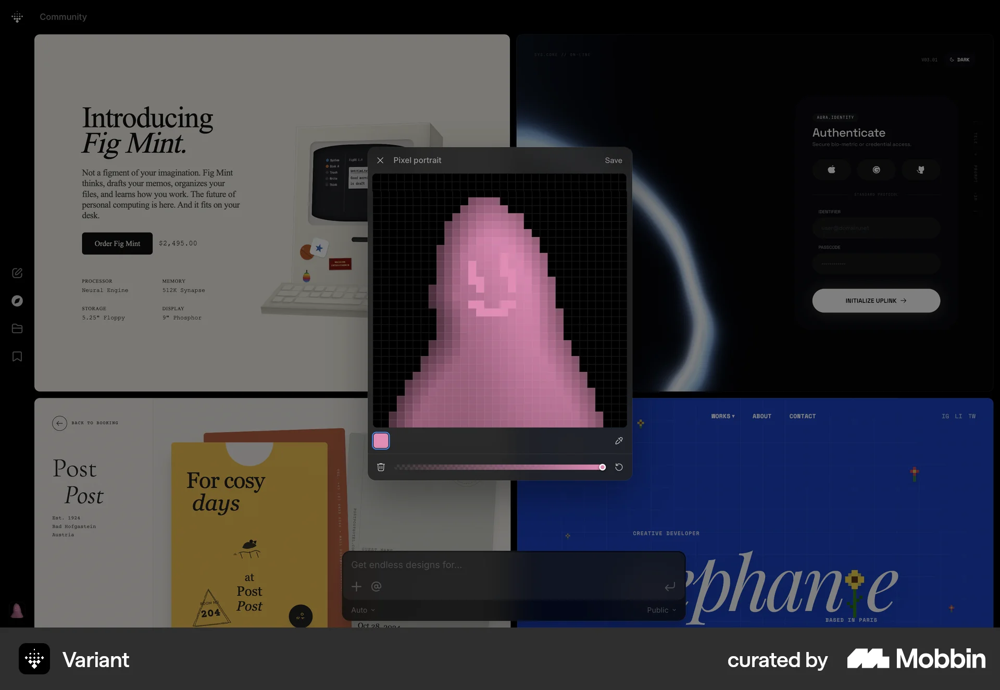

- **Seen:** "Pixel portrait" editor: chunky pink pixel figure on dark grid
- **Take / leave:** **STRONG** like: - low-res pixel silhouette exactly like our 10x10 shape; shows coarse grids read as images

### B06 · [Magnific](https://mobbin.com/screens/f9a83dae-0152-415f-81c3-2db6202ed971)

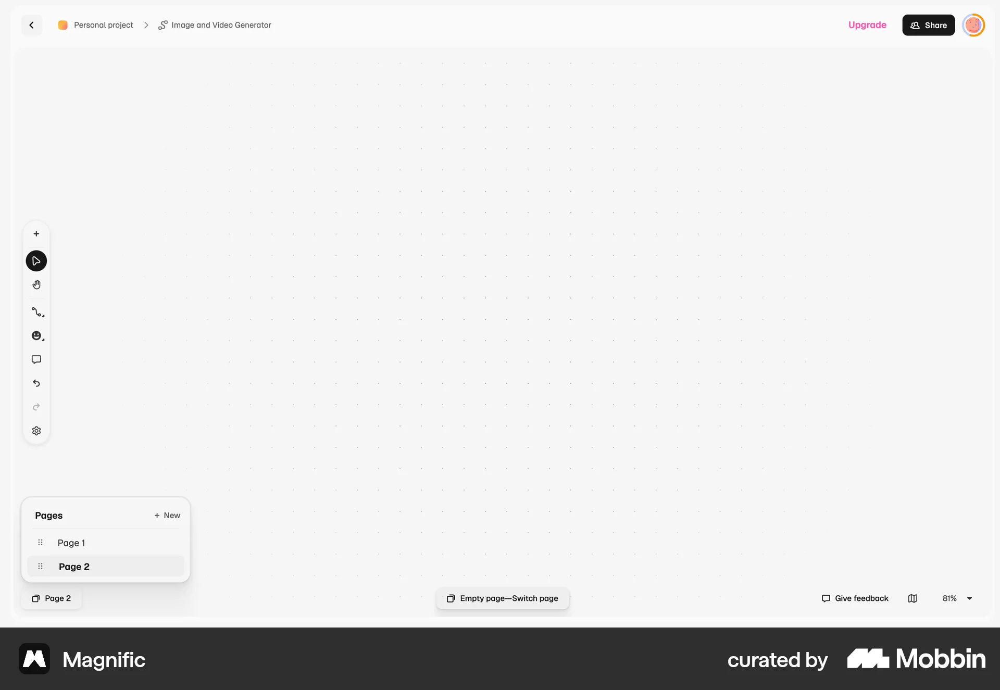

- **Seen:** light dot canvas
- **Take / leave:** Neutral. texture only

### B07 · [fal](https://mobbin.com/screens/5ddfd1ef-958b-4778-a41a-43978d92fee1)

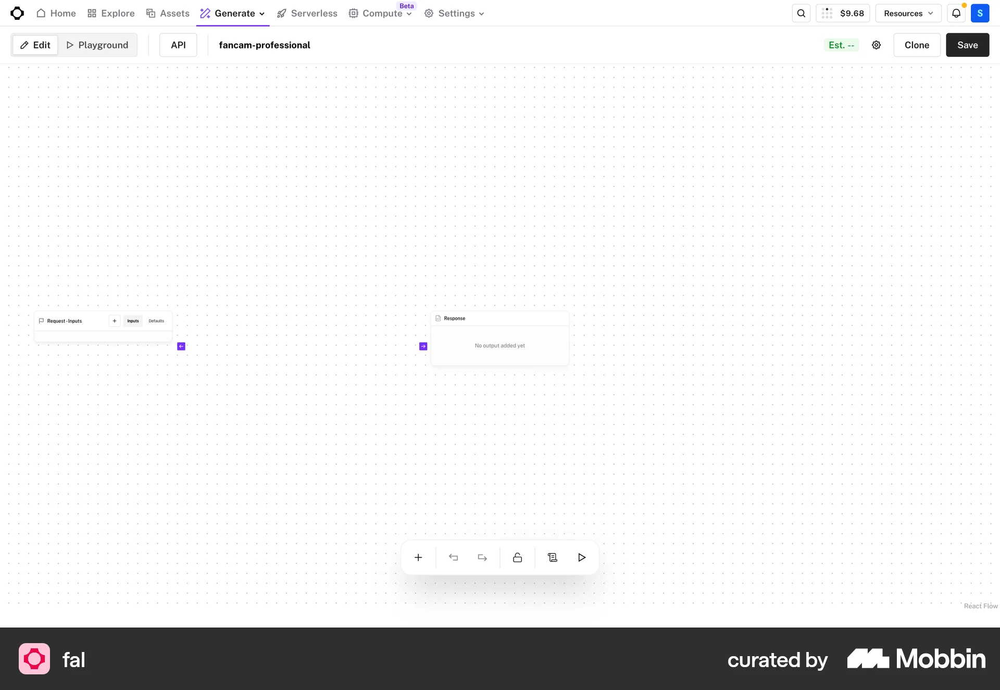

- **Seen:** node graph on dot grid
- **Take / leave:** Neutral.

### B08 · [Langdock](https://mobbin.com/screens/29337187-eff1-45b7-8302-5de2b9c22cc6)

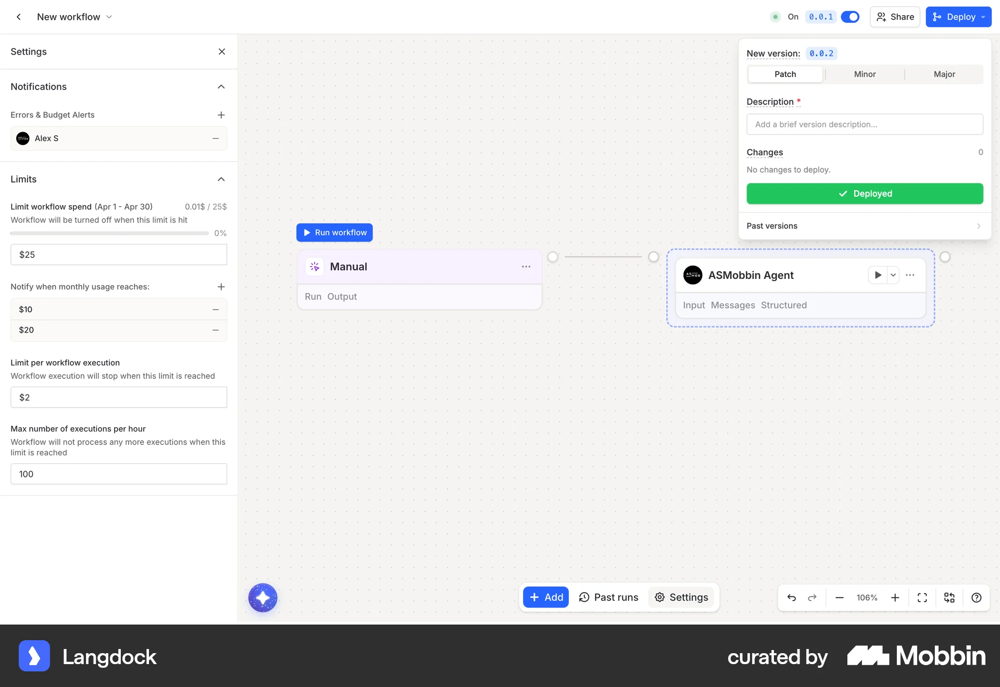

- **Seen:** workflow nodes, dashed selection outline
- **Take / leave:** Like: pipeline nodes: painting -> Gemini -> board (for "how it works")

### B09 · [Stitch](https://mobbin.com/screens/d916972e-ffd9-4763-96a3-bc84cf7868bd)

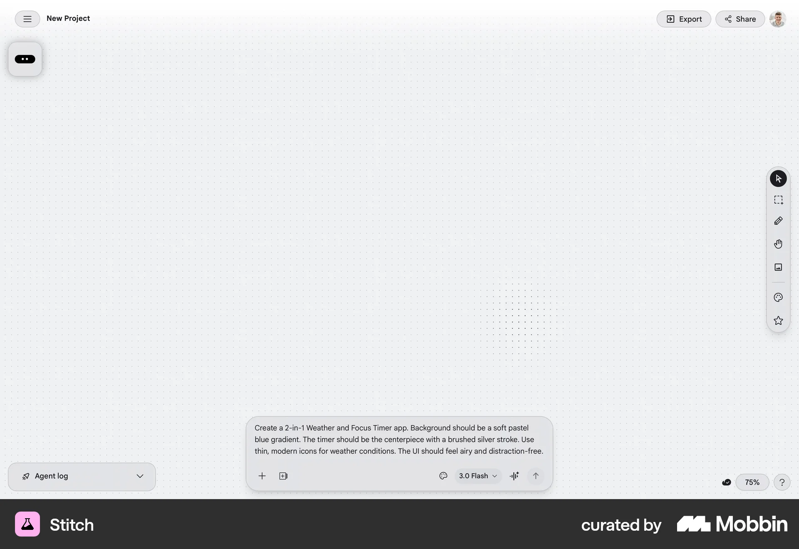

- **Seen:** dot grid where dots cluster denser bottom-right (density gradient)
- **Take / leave:** Like: dots forming a soft shape via density = halftone painting idea

### B10 · [Evernote](https://mobbin.com/screens/4640a646-8c8c-41cd-aeb0-8febd53b945d)

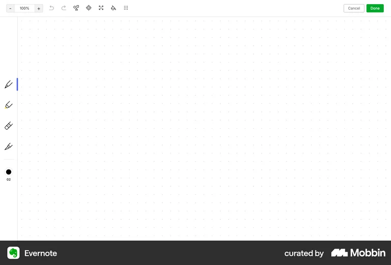

- **Seen:** dot paper canvas
- **Take / leave:** Neutral.

### B11 · [Squarespace](https://mobbin.com/screens/95009d78-fb3e-463f-a8c7-890dc033097c)

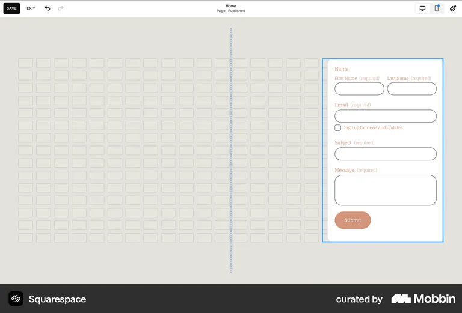

- **Seen:** warm greige grid of embossed rounded cells, serif labels, terracotta button
- **Take / leave:** Like: warm greige + debossed cells = physical board in paper/clay tones

### B12 · [Laravel Cloud](https://mobbin.com/screens/4f2ea138-1659-4559-b46a-2fbe754a60de)

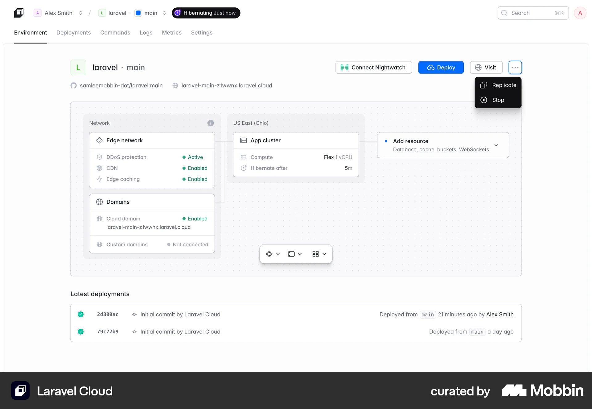

- **Seen:** infra diagram on dot grid, status "Active/Enabled" green
- **Take / leave:** Like: grouped status rows (sponsor panel)

### B13 · [Zoom](https://mobbin.com/screens/1c257e86-7ce6-40fa-bd78-7f4275552e93)

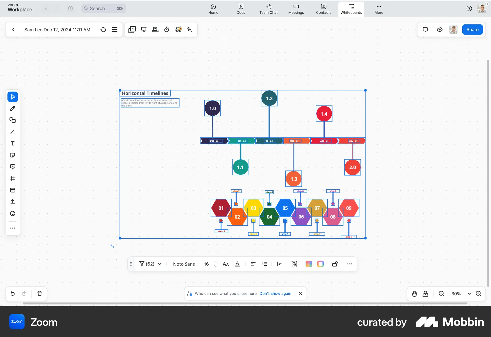

- **Seen:** horizontal timeline with numbered circles & hexes
- **Take / leave:** DISLike: noisy multicolor; Like: numbered nodes on a line (tour timeline)

### B14 · [Retool](https://mobbin.com/screens/8ad97efd-4659-4e8a-85cf-f009a305f5d7)

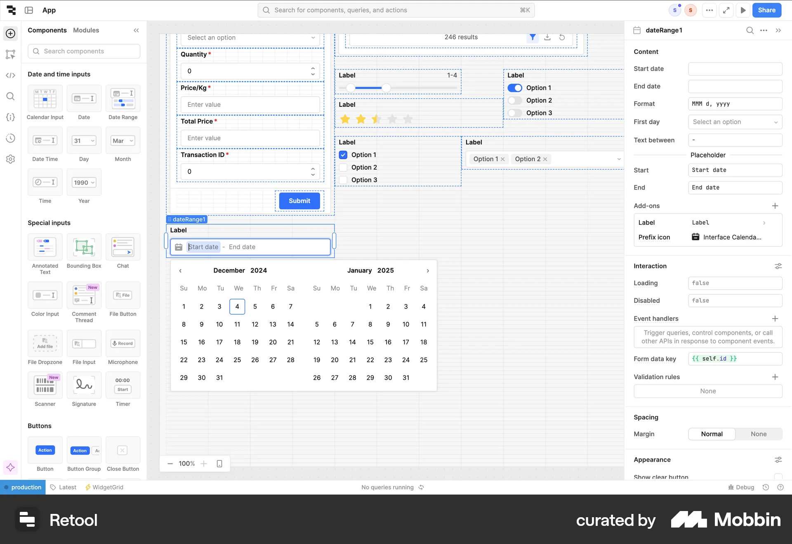

- **Seen:** calendar grid
- **Take / leave:** DISLike:

### B15 · [one year](https://mobbin.com/screens/01193399-263f-4b5b-86da-129f6f9eb1c6)

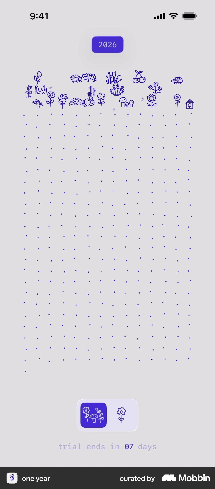

- **Seen:** year as a dot grid (one dot per day) on warm gray, hand-drawn doodle flowers growing on top, mono caption "trial ends in 07 days"
- **Take / leave:** **STRONG** like: dot grid + hand-drawn flora = teamLab flowers + our balls; mono caption w/ highlighted number

### B16 · [Universe](https://mobbin.com/screens/c28b710a-a2df-4bcd-ba9b-6b19d26d9f3d)

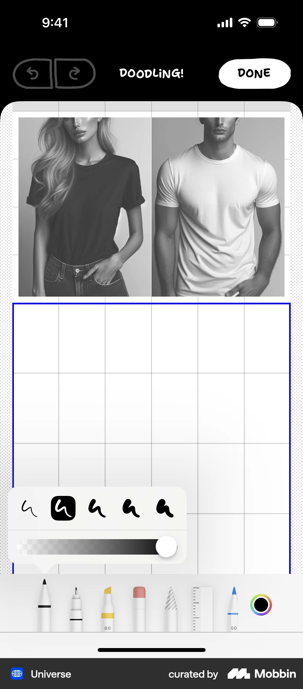

- **Seen:** photos above a coarse drawing grid, blue frame
- **Take / leave:** Neutral. "image above, grid below" stacking = painting -> board translation

### B17 · [Evernote sketch](https://mobbin.com/screens/0246d2f6-85f3-4eb3-9891-9c4e5e56f404)

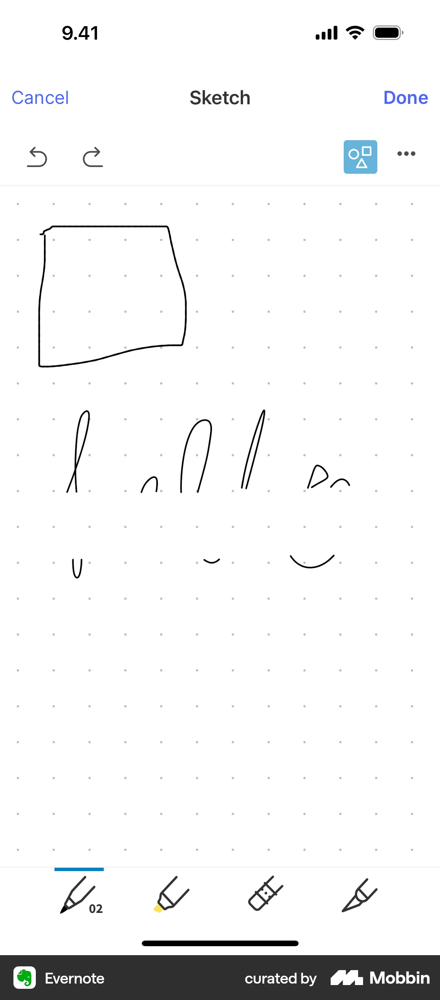

- **Seen:** wobbly hand-drawn lines on dot paper
- **Take / leave:** Like: hand-drawn wobble as character

### B18 · [Fabric](https://mobbin.com/screens/70e66a1b-4cb0-4aa3-bfdb-71424afab96d)

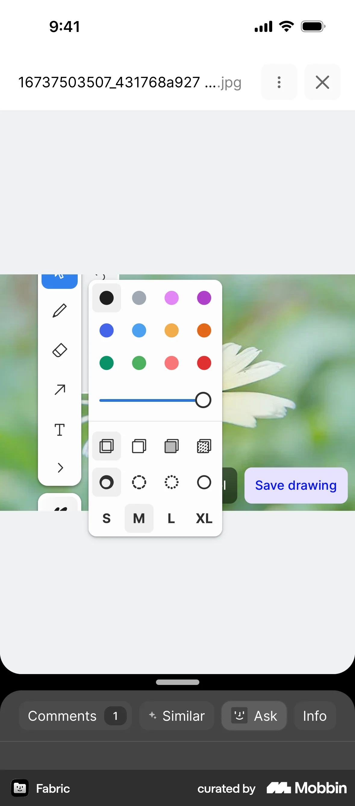

- **Seen:** brush picker w/ dotted/dashed ring styles
- **Take / leave:** Like: dashed ring = "about to rise" state

### B19 · [Tesla](https://mobbin.com/screens/e9185aa7-9613-424c-b995-08f17e9e2ae3)

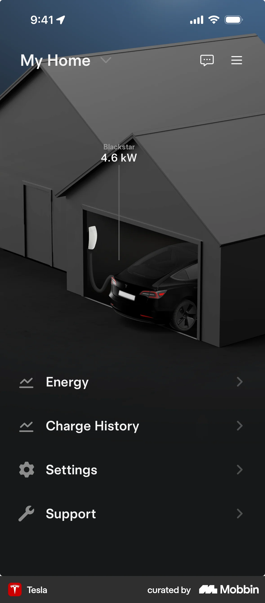

- **Seen:** dark 3D render of the house/device, leader line + "4.6 kW" label on the object
- **Take / leave:** **STRONG** like: render of the physical device with live value called out = show the real board, label the shape

### B20 · [Polestar](https://mobbin.com/screens/326365c7-df35-49a2-9fbf-fd6648ca1b2a)

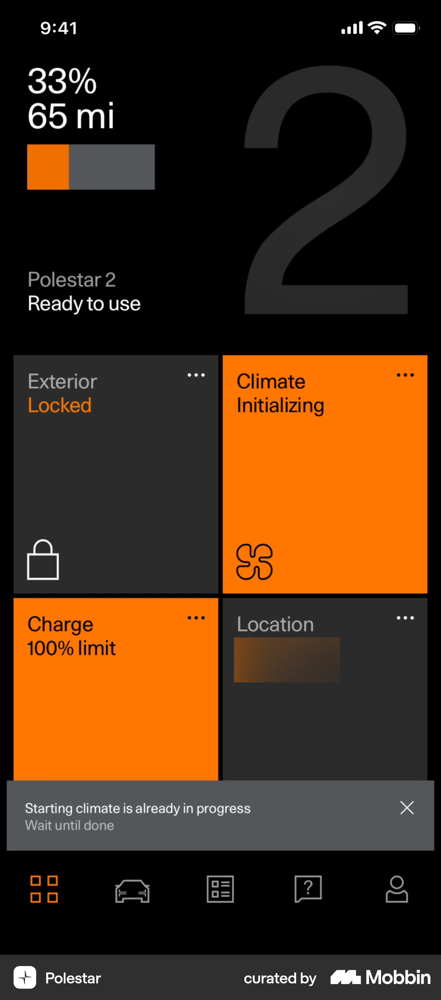

- **Seen:** giant outlined numeral "2" as backdrop, orange/charcoal tile grid, state words ("Locked", "Initializing") in accent
- **Take / leave:** **STRONG** like: huge numeral for current part number; tiles w/ status in accent color

### B21 · [Sunlitt](https://mobbin.com/screens/9b61f472-b3d8-47c6-abc9-9a9152b373bf)

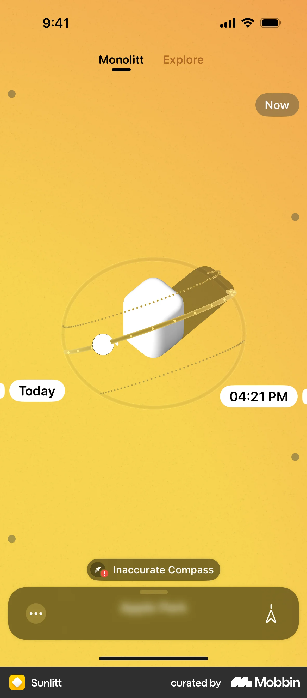

- **Seen:** 3D object lit by sun arc, warm yellow gradient, pill labels
- **Take / leave:** Like: light-and-shadow on a physical object (balls casting shadows)

### B22 · [My BMW](https://mobbin.com/screens/977d778e-2a38-4425-baf9-6339b9abc590)

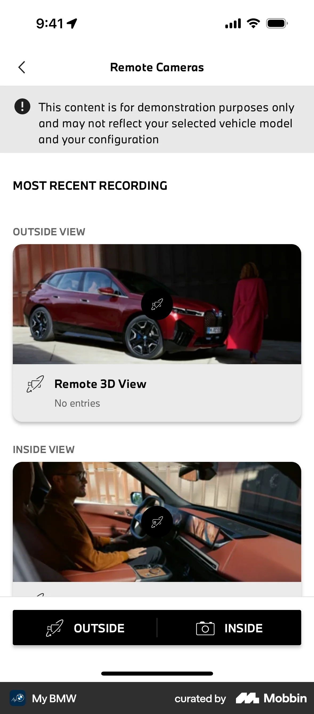

- **Seen:** "OUTSIDE VIEW/INSIDE VIEW" caps section labels over media
- **Take / leave:** Neutral.; Like: mirrored/simulated as a caps label

### B23 · [Rivian](https://mobbin.com/screens/696773dc-ad39-4fed-b98f-6e8a378c7340)

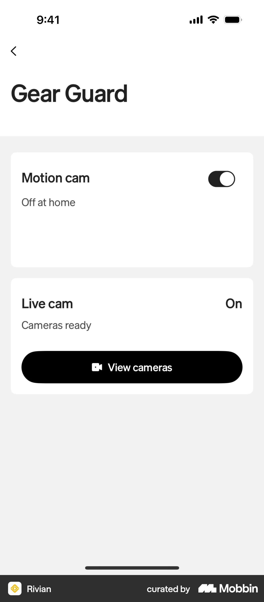

- **Seen:** "Live cam  On" title/value split
- **Take / leave:** Like: plain title-left/state-right ("Board  Mirrored live")

### B24 · [Philips Hue](https://mobbin.com/screens/e47e76e7-97ec-45f6-824b-3e179596016a)

- **Seen:** room card filled with the light's own color
- **Take / leave:** Like: device state shown as color fill

### B25 · [Alexa](https://mobbin.com/screens/54e1dd4b-64dd-4796-8c54-090ea7b6a019)

- **Seen:** dashed-border placeholder cards
- **Take / leave:** DISLike: upsell; Like: dashed = not-yet-connected state

### B26 · [SmartThings](https://mobbin.com/screens/11af9b58-3eb6-4a55-ad1d-fac26319a17c)

- **Seen:** soft blue gradient
- **Take / leave:** DISLike: generic

### B27 · [Google Home](https://mobbin.com/screens/732adb5d-fa71-45b0-995a-6001075bed6b)

- **Seen:** tinted tiles
- **Take / leave:** DISLike: generic

### B28 · [Octopus](https://mobbin.com/screens/e7babd01-ca06-4431-848f-8a4ebc55ec04)

- **Seen:** illustrated isometric house, dashed outlines for missing devices
- **Take / leave:** Like: illustration with dashed "ghost" parts

## 4. Conversation

The live transcript between the visitor and the guide (`Transcript`).

14 references.

### C01 · [Meta AI](https://mobbin.com/screens/a13d716b-b9dc-4775-9934-b5c881b221a3)

- **Seen:** gradient ring orb above large bold transcript; spoken text bold, upcoming faded
- **Take / leave:** Like: karaoke reveal: spoken words solid, rest dimmed DISLike: blue-purple AI gradient cliche

### C02 · [Mesh](https://mobbin.com/screens/ea3930d0-52f8-4590-864a-b3d0afb14b91)

- **Seen:** tool step line "Retrieved contact" w/ spinner inline in chat; thin aurora wave at bottom
- **Take / leave:** Like: agent steps inline in transcript (sponsor activity as captions!)

### C03 · [Speak](https://mobbin.com/screens/61556f91-425a-4d72-8912-56b2e0bd840e)

- **Seen:** frosted caption card over scene, original + translation
- **Take / leave:** Like: caption card over the image = subtitles overlaid on painting

### C04 · [Notion](https://mobbin.com/screens/02ba7855-7392-4218-acc7-1c9521149bdb)

- **Seen:** tiny inline waveform in a pill while recording
- **Take / leave:** Like: compact waveform indicator

### C05 · [Otter](https://mobbin.com/screens/e01cb2e6-b43c-4ccc-8765-9012fde4a1a7)

- **Seen:** timestamps above each paragraph, current paragraph highlighted mint
- **Take / leave:** Like: timestamps + highlight of current utterance

### C06 · [ElevenReader](https://mobbin.com/screens/d9a14bbf-8a4a-4536-ab0a-92a16d67fd6b)

- **Seen:** soft blue marbled orb, "Connecting..."
- **Take / leave:** Like: ElevenLabs' own orb = sponsor nod; DISLike: generic

### C07 · [ChatGPT](https://mobbin.com/screens/64be7109-fd45-4292-9010-c6ad15a88d6d)

- **Seen:** cloud-textured sky orb, huge whitespace
- **Take / leave:** Like: orb with real texture (could be painting texture!) -> orb filled with the current painting's crop

### C08 · [Claude](https://mobbin.com/screens/cf19a222-e22f-4cdf-a030-6712ef5ab8b0)

- **Seen:** big pill with bars, last utterance italic above
- **Take / leave:** Like: italic for the visitor's spoken words

### C09 · [DeepSeek](https://mobbin.com/screens/4a1d8868-4396-4ef3-9e45-7d05b159c974)

- **Seen:** long thin bar waveform "Recognising..."
- **Take / leave:** Like: full-width thin waveform as divider

### C10 · [Mindtrip](https://mobbin.com/screens/50ce7f51-fcec-4a35-aae3-dc56af5d25d1)

- **Seen:** black circle w/ bars, "Mindtrip is speaking...", word-by-word reveal, progress bar
- **Take / leave:** **STRONG** like: explicit "Guide is speaking..." label + karaoke text + progress

### C11 · [Tolan](https://mobbin.com/screens/6c567d6c-7c9b-4323-af5f-8d388e130fc4)

- **Seen:** glowing bokeh particle creature on dark; small caps title
- **Take / leave:** **STRONG** like: teamLab-like light particles on darkness

### C12 · [Tiimo](https://mobbin.com/screens/9d162dab-2f4e-4479-ba8f-f3df763b5c46)

- **Seen:** hand-drawn character + serif "I'm listening, ask me anything"
- **Take / leave:** Like: hand-drawn illustration + serif = personal craft

### C13 · [Slack](https://mobbin.com/screens/6eee8712-09f7-490d-b385-29206b5b9eff)

- **Seen:** closed-captions list: avatar + name + line
- **Take / leave:** Like: caption list readable from distance; DISLike: repeated name per line

### C14 · [X/Grok](https://mobbin.com/screens/eded2c9f-7537-4f65-9a96-87fce3023552)

- **Seen:** "Answer" label then text
- **Take / leave:** Neutral.

## 5. Speaking indicator (new)

Who is talking right now. Inferred from the last transcript line, because screen.py does not stream audio state.

12 references.

### V01 · [Delphi talking](https://mobbin.com/screens/f495e1b5-5a89-4592-a7e4-42ee9d511c87)

- **Seen:** avatar w/ concentric peach rings radiating + "Talking ▪▮" pill
- **Take / leave:** **STRONG** like: concentric ripple rings = ripple in water (teamLab) + clear state label

### V02 · [ElevenLabs](https://mobbin.com/screens/cf492872-e47b-453b-b476-0b5495411a83)

- **Seen:** ElevenLabs' own swirl orb + transcript right w/ [warmly] emotion tag; "Live 100%"
- **Take / leave:** Like: sponsor-native orb; emotion tags in transcript

### V03 · [PlayAI](https://mobbin.com/screens/3048235f-760d-4ec2-bf7e-b5c264715402)

- **Seen:** mono caps "VOICE AGENT IN CONVERSATION", waveform made of dots inside a dot circle, "responding..."
- **Take / leave:** **STRONG** like: waveform drawn from DOTS = our ball board language

### V04 · [Preply](https://mobbin.com/screens/82d67cb1-1a50-4442-a83a-afb56472ca75)

- **Seen:** thin pink tick waveform "Waiting for results from your microphone..."
- **Take / leave:** Like: thin tick marks as idle listening

### V05 · [Discord](https://mobbin.com/screens/14f57587-c47b-491d-8eac-2b55942e47e1)

- **Seen:** "Voice Connected" green + speaking ring around avatar
- **Take / leave:** DISLike: clutter

### V06 · [Mercor](https://mobbin.com/screens/1c204e23-a93b-4fd1-ae71-55597430488d)

- **Seen:** single periwinkle disc w/ soft halo on gray
- **Take / leave:** Like: single disc = one ball; DISLike: flat

### V07 · [Telegram](https://mobbin.com/screens/785abc69-5238-4e05-a919-453a8d5e5e45)

- **Seen:** participant row: name + green "speaking" text + mic icon
- **Take / leave:** Like: plain text "speaking" label next to name (accessible, no color-only)

### V08 · [Dialpad](https://mobbin.com/screens/211fb12e-7422-4541-8f20-31338c75b98b)

- **Seen:** "Transcribing" chip w/ tiny level meter
- **Take / leave:** Neutral.

### V09 · [Hotjar](https://mobbin.com/screens/9acc01be-dbe8-40e8-b2ec-5726a28f1425)

- **Seen:** red rec timer pill "04:38"
- **Take / leave:** Neutral.

### V10 · [Shopify Sidekick](https://mobbin.com/screens/abec76be-27e9-4e26-8601-c22394fc6c4c)

- **Seen:** soft iridescent glow around avatar
- **Take / leave:** DISLike: AI-iridescence cliche

### V11 · [ClickUp](https://mobbin.com/screens/7b75331e-872b-4d19-b099-e9ffd8c63e62)

- **Seen:** active speaker tile gets dark outline
- **Take / leave:** Like: outline-only active state (no glow)

### V12 · [Delphi thinking](https://mobbin.com/screens/d9eb6fae-7d9e-43cc-a217-f94e60d33003)

- **Seen:** progress arc ring + "Thinking •••" pill
- **Take / leave:** **STRONG** like: third state "Thinking" between turns (= tool call / board moving)

## 6. Tour progress (new)

The parts list turned into a journey through the painting.

14 references.

### T01 · [Gusto](https://mobbin.com/screens/afd1032f-ef50-460f-88fb-c1e6970ab079)

- **Seen:** vertical rail; solid line for done, dotted for upcoming; half-filled circle for in-progress
- **Take / leave:** **STRONG** like: solid vs dotted rail = toured vs not yet; half-moon "in progress" glyph

### T02 · [Sana AI](https://mobbin.com/screens/0e3294a6-e6b9-4d3a-acbd-3d8f3c69119a)

- **Seen:** numbered cards connected by dashed vertical line, title + one-line description
- **Take / leave:** Like: number + name + 1-line description per part

### T03 · [Hers](https://mobbin.com/screens/fcd9f589-d477-4466-8f92-9cf45f35765d)

- **Seen:** black filled numbered circles w/ serif-ish heading, hairline dividers
- **Take / leave:** **STRONG** like: editorial: serif numerals in black discs, hairline rules

### T04 · [Time2book](https://mobbin.com/screens/7108e7fa-76da-4616-9d1d-edddf9a6cb40)

- **Seen:** list w/ done items greyed + green check, current one bold w/ action
- **Take / leave:** Like: current item full contrast, others faded (hierarchy by contrast)

### T05 · [Brilliant](https://mobbin.com/screens/47c242d9-d1f7-4363-8c69-e3ce38c85b81)

- **Seen:** horizontal 3-node timeline, gradient-filled progress segment, serif headline
- **Take / leave:** Like: horizontal rail under painting w/ filled progress; DISLike: pastel gradient

### T06 · [Remote](https://mobbin.com/screens/5a7aed09-5be9-4ded-a7b6-b3ad8271db98)

- **Seen:** blue sidebar, check-circles connected by line
- **Take / leave:** Neutral.; corporate

### T07 · [Employment Hero](https://mobbin.com/screens/4852a8e5-f3d8-44fc-97ac-f94fd950b7f4)

- **Seen:** horizontal stepper + lifecycle table w/ COMPLETED/IN PROGRESS/NOT STARTED caps badges
- **Take / leave:** Like: caps status badges language (sponsor panel)

### T08 · [Etsy](https://mobbin.com/screens/4f49b42a-5b33-4b6a-8646-d4d3df9f3306)

- **Seen:** top stepper: checkmarks -> big black dot current -> grey dots future; serif headline
- **Take / leave:** **STRONG** like: big solid dot = current, tiny dots future (like balls!)

### T09 · [Zillow](https://mobbin.com/screens/090173cd-511e-4466-ae39-2b0f98c60f5d)

- **Seen:** full blue rail w/ check nodes; current node halo ring
- **Take / leave:** Like: halo ring on current node

### T10 · [Pipedrive](https://mobbin.com/screens/d502c182-036b-4f89-a9c8-69c2481db846)

- **Seen:** compact 4-step stepper in modal
- **Take / leave:** Neutral.

### T11 · [Gamma](https://mobbin.com/screens/523d6c4f-ac58-44f7-9d7a-a9881cba40f7)

- **Seen:** vertical checklist w/ spinner on active step ("Analyzing the logo...")
- **Take / leave:** Like: spinner inline on active step = live pipeline (Gemini finding parts)

### T12 · [Upwork](https://mobbin.com/screens/fea3d487-8423-4441-a35f-9f68a937bd85)

- **Seen:** green checks, pencil icon on current, numbered future
- **Take / leave:** Neutral.

### T13 · [Docusign](https://mobbin.com/screens/3cafab73-f09f-440f-825a-51bbf6063102)

- **Seen:** "3/5 completed" + progress bar
- **Take / leave:** Like: fraction label "3 / 6 parts"

### T14 · [Graphite](https://mobbin.com/screens/d5e25ee0-a30a-4bbe-bc78-e2fb213e811d)

- **Seen:** done = strikethrough, current = expanded card, future = faded
- **Take / leave:** Like: current part expanded with description, others collapsed

## 7. Sponsor activity panel (toggleable)

What ElevenLabs, Gemini, Creao and Browser Use are doing (`ActivityBar`).

14 references.

### A01 · [Browserbase](https://mobbin.com/screens/38e3e1bc-2a5c-4f7b-aa64-00ab6f736224)

- **Seen:** step log with colored type tags (Prompt/Reason/Tool) + mono timestamps, "Running" chip, orange ticks on timeline
- **Take / leave:** Like: type tag + mono time per event (Browser Use is literally this kind of product)

### A02 · [Braintrust](https://mobbin.com/screens/eeca0b54-0262-4eef-8a76-f548fe84a384)

- **Seen:** dense log table, errors in pink rows
- **Take / leave:** DISLike: too dense for a demo screen; Like: error rows tinted

### A03 · [Relevance AI](https://mobbin.com/screens/db919f38-24cb-4151-b995-2781392d7db2)

- **Seen:** timeline: "1 step performed in the background", "Used <tool>" lines, Completed badge
- **Take / leave:** Like: "Used X" plain-language lines

### A04 · [Replit](https://mobbin.com/screens/20a3ac62-d3ef-4bd1-9feb-235af79faa5c)

- **Seen:** narration feed + collapsed "4 actions" icon rows; serif "Replit Agent is building..." in empty preview
- **Take / leave:** Like: serif empty-state headline; collapsed action counts

### A05 · [Emergent](https://mobbin.com/screens/4a3b2d78-ee1c-406f-824e-6a5d5f4fa8a8)

- **Seen:** "Agent is running..." green banner, "Sprinkling some magic..."
- **Take / leave:** Like: human status copy; DISLike: cutesy

### A06 · [Cursor](https://mobbin.com/screens/58450174-4034-4e5d-a126-9def2378b0a0)

- **Seen:** agent cards w/ status pills (Draft/Branch/Merged), filter menu
- **Take / leave:** Neutral.

### A07 · [Base44](https://mobbin.com/screens/33aa43c9-ee32-4bbb-9447-f79cf2b11cdc)

- **Seen:** slide-over "Activity Monitor" drawer, method tag + path + green 200
- **Take / leave:** **STRONG** like: slide-over drawer = toggleable sponsor panel that doesn't reflow layout

### A08 · [fal](https://mobbin.com/screens/4291ed3d-a9ea-46e1-92ac-d47c42fcda36)

- **Seen:** history cards w/ time, duration, 200 badge, output thumbnail right
- **Take / leave:** Like: output thumbnail next to each agent (show what Gemini produced: the grid)

### A09 · [Hume AI](https://mobbin.com/screens/e9c5c6bd-98b3-4dd6-bd24-98c97d8ed846)

- **Seen:** sparse table, "User ended · 29 events · 2 minutes"
- **Take / leave:** Like: middot-separated meta line

### A10 · [OpenAI Platform](https://mobbin.com/screens/66f02e38-da7c-43fe-bce9-4d400bf5f999)

- **Seen:** logs table input/output
- **Take / leave:** DISLike: dev-tool density

### A11 · [Firecrawl](https://mobbin.com/screens/5b1dd18c-a214-40ff-b0a6-2e9c5668aa59)

- **Seen:** mono caps "COMPLETED" in green, halftone dot texture top-right of header
- **Take / leave:** Like: mono caps status text instead of pill; halftone dots decor

### A12 · [n8n](https://mobbin.com/screens/1562fe41-4f0a-48b9-b6da-ed9ebf8b9ec5)

- **Seen:** node graph (trigger -> agent -> tools) w/ live logs "Running for 1s" spinners
- **Take / leave:** **STRONG** like: pipeline diagram showing which node is live = "how it works" panel

### A13 · [LangChain](https://mobbin.com/screens/530a288a-6583-435f-8df7-dc6a87393516)

- **Seen:** nested trace tree w/ durations
- **Take / leave:** DISLike: too technical

### A14 · [Cloudflare](https://mobbin.com/screens/db64bfde-eac6-4786-8c29-62b98eb1a149)

- **Seen:** "Live" toggle button, event histogram, timestamped rows
- **Take / leave:** Like: "Live" pill wording + tiny histogram

## 8. Header and live status

Wordmark, live / offline state, session meta.

10 references.

### H01 · [Heidi](https://mobbin.com/screens/74fd3e6d-c80f-4a55-b92d-54a89f722a43)

- **Seen:** "00:05" timer + live green mic level bars + "Stop transcribing" w/ red dot; hand-drawn arrow in empty state
- **Take / leave:** Like: session timer + mic level bars; hand-drawn arrow = craft

### H02 · [Grain](https://mobbin.com/screens/72ec9f61-b757-4a61-9321-3f4907b60ac2)

- **Seen:** dark top strip: red dot "Recording" under title
- **Take / leave:** Like: quiet two-line status under name

### H03 · [Loom](https://mobbin.com/screens/a8dc3d96-4c09-4271-9fe5-7d02e4a55d5d)

- **Seen:** floating dark pill control bar w/ 0:00 timer
- **Take / leave:** Like: floating pill (toggle sponsor panel / keyboard hints)

### H04 · [Substack live](https://mobbin.com/screens/0be1295e-7fee-4dfd-9341-c55a6fb9ae10)

- **Seen:** red "LIVE" tag + 0:38 + viewer count centered in top bar
- **Take / leave:** **STRONG** like: compact "LIVE 0:38" tag

### H05 · [Riverside](https://mobbin.com/screens/134ca07c-7482-4365-af08-38254975cc9c)

- **Seen:** lower-third title overlay "Product Design 101" on video
- **Take / leave:** Like: broadcast lower-third for painting title over the art

### H06 · [Paramount+](https://mobbin.com/screens/d96044ef-7bd6-484f-8ddd-ecd217e5b2b8)

- **Seen:** tiny "• LIVE" chip bottom-left of full-bleed video
- **Take / leave:** Like: minimal live chip in a corner, content dominates

### H07 · [Vimeo](https://mobbin.com/screens/ff67ec2c-d6fc-45ca-a4cd-67a364a681b5)

- **Seen:** "1080p" corner badge on stage
- **Take / leave:** Like: corner meta badge ("SIMULATED" / "MIRRORED")

### H08 · [Dribbble](https://mobbin.com/screens/d04870fa-6bfc-4a29-9a42-e86b3653b0cb)

- **Seen:** script wordmark top-left, gray stage
- **Take / leave:** Like: handwritten-style wordmark = personality

### H09 · [ClickUp](https://mobbin.com/screens/c411bc60-41a8-4309-8c2b-225315b78c01)

- **Seen:** pink "Recording" pill top-right
- **Take / leave:** Neutral.

### H10 · [Visitors](https://mobbin.com/screens/269dcad7-6c94-471f-a59a-5e33df3bb141)

- **Seen:** globe + dark card "No active visitors... someone may drop by." w/ single purple dot
- **Take / leave:** **STRONG** like: warm empty-state copy for offline state

## 9. Idle / attract screen (new)

What passing judges see before a tour starts.

28 references.

### I01 · [Museum of the Human Web](https://mobbin.com/sites/sections/44c02d89-52ab-457f-a72c-ed5423e28a45)

- **Seen:** single object centered on white, mono "ENTER THE MUSEUM ↵" key-cap button, mono era radio pills
- **Take / leave:** Like: mono keycap CTA ("press space to begin"), era pills = painting picker

### I02 · [Dropbox](https://mobbin.com/sites/sections/54222b25-4812-4604-9e5c-ed74a7c6b232)

- **Seen:** split: dark text column / full-bleed mural photo
- **Take / leave:** Like: 40/60 split text art

### I03 · [Harvest "Time in this Time"](https://mobbin.com/sites/sections/b4707698-4dc8-429f-b614-acb56a904188)

- **Seen:** blurred artwork bg, italic serif kicker + grotesk headline + hairline + "A work by"
- **Take / leave:** **STRONG** like: kicker/title/byline lockup = painting title card; blurred painting as backdrop

### I04 · [Museum of the Human Web](https://mobbin.com/sites/sections/62a1a23c-bccc-4411-b9e7-712975ae4494)

- **Seen:** condensed serif "MUSEUM OF THE HUMAN WEB" wordmark w/ striped "O"
- **Take / leave:** Like: wordmark where one letter is replaced by an object (our O = a raised ball / 10x10 grid)

### I05 · [Harvest b2](https://mobbin.com/sites/sections/30f61f31-b69e-416f-9b57-8c309c689426)

- **Seen:** spaced mono caps title, italic serif subtitle, terracotta->pink gradient
- **Take / leave:** Like: mono + italic serif pairing; DISLike: gradient

### I06 · [Eventbrite](https://mobbin.com/sites/sections/d2ac77c3-af65-4cfb-9f59-227d98a51578)

- **Seen:** condensed caps over photo, O replaced by a ring
- **Take / leave:** Like: ring-as-letter again

### I07 · [Studio Freight](https://mobbin.com/sites/sections/37214c10-d891-48bc-a46e-6050033671b4)

- **Seen:** giant mono-serif staggered words "WE PRACTICE THE ART OF" + image inset in the type
- **Take / leave:** **STRONG** like: huge staggered type w/ image as a word; mono nav micro type

### I08 · [Cosmos](https://mobbin.com/sites/sections/bfbc4274-51e7-46d2-8ca0-d2b5e03916a7)

- **Seen:** triptych of art crops behind search pill
- **Take / leave:** Like: triptych of the 4 demo paintings

### I09 · [COLLINS](https://mobbin.com/sites/sections/321fcd6b-4945-4a1a-b2c5-6f0d6bfad8f4)

- **Seen:** painterly "HOPE" on near-black, small serif "Learning to see.", segmented progress dashes bottom-left
- **Take / leave:** **STRONG** like: "Learning to see." tone; carousel dashes for rotating paintings

### I10 · [Studio Freight empty](https://mobbin.com/sites/sections/c88d7a4b-61f2-4217-8818-80213f9cd809)

- **Seen:** blank w/ micro mono nav
- **Take / leave:** Neutral.

### I11 · [NEON](https://mobbin.com/sites/sections/1d1863b3-a450-4317-9765-12ae9994db64)

- **Seen:** heavy condensed caps on slate + hairline arrow
- **Take / leave:** Like: poster caps; DISLike: low contrast black-on-slate

### I12 · [Runway](https://mobbin.com/sites/sections/a139d1ae-1780-4161-958b-2e15832c59f2)

- **Seen:** cut-out objects floating on greige, large serif "RNA Sessions"
- **Take / leave:** Like: greige paper + big serif

### I13 · [IKEA Museum](https://mobbin.com/sites/sections/9106b15a-0086-4cfc-a085-66d514b20408)

- **Seen:** huge bold white headline over full-bleed photo
- **Take / leave:** Neutral.; generic

### I14 · [Selfridges](https://mobbin.com/sites/sections/025e1aa3-21a8-4993-8d90-fd04c499f268)

- **Seen:** condensed caps over photo + date
- **Take / leave:** Neutral.

### I15 · [Cosmos dark](https://mobbin.com/sites/sections/5262f136-e0e1-4d69-bb6b-19673552612f)

- **Seen:** b&w flowers barely visible in black, "You are now entering the Cosmos.", "Best experienced with headphones."
- **Take / leave:** **STRONG** like: darkness + faint flowers = teamLab room; "best experienced with..." -> "Best experienced with your hands."

### I16 · [Unseen Studio](https://mobbin.com/sites/sections/64611226-7921-4e34-9001-83c7e91bd803)

- **Seen:** chromatic-aberration "UNSEEN" wordmark on charcoal
- **Take / leave:** Like: name concept "unseen"; DISLike: glitch is cliché

### I17 · [KODE Immersive](https://mobbin.com/sites/sections/9e9698c5-fa1a-4103-afd4-dd4bb1fbf82a)

- **Seen:** saturated orange field, scattered letters, bracket labels "[ SOUND ON ]"
- **Take / leave:** Like: bracket micro-labels "[ LIVE ]"

### I18 · [Grok/xAI](https://mobbin.com/sites/sections/30ab578c-5e08-4070-905a-146bc41a8e12)

- **Seen:** starburst of particles, split headline
- **Take / leave:** Like: particles converge = balls rising; DISLike: sci-fi tone

### I19 · [Cosmos peony](https://mobbin.com/sites/sections/b3994ca2-d26a-4d79-b1e9-fd4bc4c62410)

- **Seen:** huge monochrome peony, centered light sans line
- **Take / leave:** Like: monochrome art + one line

### I20 · [Craft Agency](https://mobbin.com/sites/sections/b78a24fd-b6be-438a-914c-aaddfe392990)

- **Seen:** blank deep green
- **Take / leave:** DISLike: (empty capture)

### I21 · [Melius](https://mobbin.com/sites/sections/3f4ed450-3eec-4694-acd7-5176809c4b32)

- **Seen:** flower meadow photo in rounded frame on near-black dot grid, yellow sticky card
- **Take / leave:** Like: dot-grid border texture + framed art

### I22 · [Oryzo](https://mobbin.com/sites/sections/eb2b0592-0e9c-4eb4-8cc6-d0ab6ab1b9c3)

- **Seen:** macro rock/bark texture full-bleed
- **Take / leave:** **STRONG** like: raking-light texture = "touchable" surface; macro of painting brushstrokes!

### I23 · [Save.design](https://mobbin.com/sites/sections/1a5c69d0-2689-4ea2-8f39-ae8048ed52fe)

- **Seen:** starfield of tiny colored dots, serif-ish headline
- **Take / leave:** Like: sparse colored dots as ambient

### I24 · [Phantom](https://mobbin.com/sites/sections/91667ea8-0891-4eae-a102-8925a108f6f2)

- **Seen:** inline mascot inside headline
- **Take / leave:** Neutral.

### I25 · [Square](https://mobbin.com/sites/sections/f3b33314-0ee1-476c-b4b8-f1e5d5d0f2a0)

- **Seen:** serif headline inside rounded photo tile on black
- **Take / leave:** Like: serif on photo

### I26 · [Chronicle](https://mobbin.com/sites/sections/ae44c0d6-872d-4892-9c35-d2a07fcb9904)

- **Seen:** outline-only giant wordmark across bottom of black, light-flare on button
- **Take / leave:** **STRONG** like: giant hairline-outline wordmark as backdrop

### I27 · [Coda](https://mobbin.com/sites/sections/0fca63d1-842d-453b-82e7-810992646b45)

- **Seen:** mono kicker "READY TO GROW?" + heavy caps + dashed side rules
- **Take / leave:** Like: mono kicker above display

### I28 · [Cosmos stones](https://mobbin.com/sites/sections/75a25da0-1ee1-4e38-b9a2-c4d33d8a8518)

- **Seen:** dark 3D pebbles orbiting a light serif "Start your journey"
- **Take / leave:** **STRONG** like: tactile 3D objects (balls!) floating around serif headline
